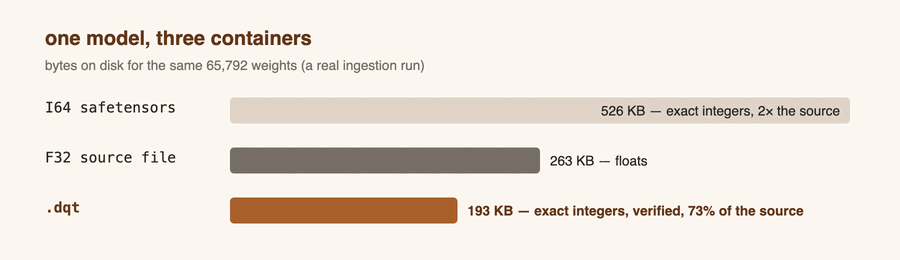

# .dqt tensor files

*Requires Maned 0.4.0 or newer. `maned-run --version` tells you what you have;
[Install](install.html) covers upgrading.*

Every tensor a Maned program touches is a decimal-scaled integer. The file
formats the ML world ships are not: floats in safetensors, `.npy`, `.gguf`.
[Packed weights](packed-weights.html) covers crossing that boundary for
compute. **`.dqt`** is the other half of the story: a tensor *container* that
is integer-native the way the language is — every stored value is already a
decimal-scaled integer at a per-tensor scale, so writing results and reading
them back never crosses a float boundary at all.

Four promises hold throughout this page:

- **Exact.** A `.dqt` file stores your integers and their decimal scale,
  nothing else. Reading at a different `quantres` rescales *exactly* —
  multiplying up refuses on overflow rather than wrapping, dividing down
  rounds half-even with every inexact division counted in a note.
- **Verified.** Every read checks per-tile and per-tensor integrity. A file
  that is corrupt, truncated or not what it claims is refused with the
  precise reason ([E026](guides/diagnostics.html)) — never partially loaded.
- **Deterministic.** The writer is canonical: the same tensors produce the
  same bytes, every run, every platform. Files are safe to diff, hash,
  cache and compare.
- **Small.** Converted model weights typically land *smaller than the float
  source file* while carrying exact integers — and the conversion prints a
  receipt so the claim is measured on your data, not assumed.

## Writing results

An `out::` directive with `dqt(path, name)` exports a flow result or an
input. A file holds many tensors, so the name is never optional — and every
directive naming the *same* path collects into one multi-tensor file,
written once at the end of the run:

```mnd
mnd::quantmax=1000;
mnd::quantmin=-1000;
mnd::quantres=2;

in::x = [150, -275, 42, 8];

calc::lambda_flow f(x) {
  x relu t =
} return t;

out::t = dqt("/tmp/dqt_roundtrip.dqt", "demo.t");
out::x = dqt("/tmp/dqt_roundtrip.dqt", "demo.x");
```

```text
$ maned-run roundtrip_write.mnd
flow 'f' outputs:
t : [4] = [150, 0, 42, 8]
note: dqt '/tmp/dqt_roundtrip.dqt': 2 tensor(s), 648 bytes at scale 10^-2
out::t -> /tmp/dqt_roundtrip.dqt
out::x -> /tmp/dqt_roundtrip.dqt
```

Values are stored at the program's `quantres` — here `scale_pow10 = 2`, so
the stored integer 150 means the real value 1.50. Because same-path
directives deliberately collect rather than overwrite, lint's usual
"later write wins" warning (W009) does not apply to `dqt`. Two directives
exporting the same *tensor name* into one file refuse with
[E028](guides/diagnostics.html) instead of silently merging.

## Reading tensors

`in::` with the same two-argument shape loads one named tensor:

```mnd
mnd::quantmax=1000;
mnd::quantmin=-1000;
mnd::quantres=2;

in::w = dqt("/tmp/dqt_roundtrip.dqt", "demo.x");

calc::lambda_flow g(w) {
  w w add s =
} return s;
```

```text
$ maned-run roundtrip_read.mnd
flow 'g' outputs:
s : [4] = [300, -550, 84, 16]
```

The file carries each tensor at its own scale; this program runs at the same
`quantres` the writer used, so the integers pass through untouched — zero
notes. At a *different* `quantres` the reader rescales exactly and tells you
what that cost. Here a file stored at `10^-5` is read by a `quantres=2`
program:

```text
note: dqt 'model.bias': rescaled from 10^-5 to the program 10^-2 (shift -3)
note: dqt 'model.bias': 222 value(s) rounded half-even in the down-rescale
```

Shifting up (a file coarser than your program) is always exact, and refuses
with [E027](guides/diagnostics.html) if a value would overflow rather than
delivering a wrapped number. A shift beyond ±18 decimal places refuses
outright. `dqt` inputs resolve on the coordinator before dispatch, so they
work unchanged when the flow routes to a [remote worker](guides/remote-workers.html)
— and `--verify` covers them like any other input.

`safetensors(...)` and `packed(...)` remain the read-only float-shard
loaders; `.dqt` is the format your programs *write*, and the same file
round-trips bit-identically.

## Converting model files

`tensor::ingestion` converts a weight file — or a folder tree, recursively —
into the integer world at one folder-wide decimal scale. `format="dqt"`
selects this container as the output:

```mnd
tensor::ingestion("model_f32.safetensors", "model.dqt", quantres=2, format="dqt");
```

```text
note: ingestion scale: 10^-5 per unit (3 precision places + 2 quantres zeros), 1 file(s), 65792 float value(s), max |value| 2.507000
note: ingestion wrote 'model.dqt' (2 tensors): source 263168 B, I64-safetensors equivalent 526336 B, dqt 193446 B
note: ingestion dqt receipt: 193446 B written = 73% of the source, 36% of the I64-safetensors equivalent; peak in-memory payload 719782 B
```

That is a real run over an F32 shard: the `.dqt` lands at **73% of the float
source** — carrying *exact* integers where the naive integer encoding
(`format="safetensors"`, the I64 twin) costs 2× the source. The receipt
prints every time, so "smaller" is a measurement, not a promise.



Input files are detected by their magic bytes, never by extension trust:

- **safetensors** — any float dtype through the exact decimal scan; integer
  dtypes pass through at scale 0.
- **`.npy`** — NumPy v1–v3, C-order little-endian numeric dtypes; the one
  tensor is named after the file's basename. Fortran order, big-endian and
  object dtypes refuse by name; `.npz` is skipped with the unzip workaround
  named.
- **`.gguf`** — llama.cpp model files, v2 and v3: unquantized tensors
  (F32/F16/BF16/F64, I8..I64) plus the quantized types Q4_0, Q4_1, Q5_0,
  Q5_1, Q8_0 and the Q4_K/Q6_K pair — the `Q4_K_M` family. Dequantization
  matches llama.cpp's own bit for bit, and every dequantized value is an
  exact binary rational, so the decimal scan loses nothing. Other quant
  types refuse by name, with the `llama-quantize` re-quantize workaround
  spelled out.

Tensor names are mangled to the `.dqt` charset (`A–Z a–z 0–9 _ . + -`,
anything else becomes `_`); if two names collide after mangling, the file is
refused rather than silently merged.

## The constraints, honestly

- **Reads always verify.** There is no fast-and-unchecked mode; a damaged
  file is a refusal ([E026](guides/diagnostics.html) carries the container's
  own error code verbatim), not a quiet wrong answer.
- **Rescale limits are refusals, not approximations.** Overflow on an
  up-shift is [E027](guides/diagnostics.html) naming the value; shifts
  beyond ±18 decimal places refuse; down-shifts round half-even and are
  counted in a note.
- **One canonical file per path, written at end of run.** Same-path `out::`
  directives collect; same-name exports refuse with
  [E028](guides/diagnostics.html). Exports are written at the program's
  `quantres`.
- **Names are constrained** to the charset above, 1–256 bytes, and
  post-mangle collisions refuse the conversion.
- **Quantized `.gguf` coverage is the list above.** A type outside it is a
  named refusal with a workaround, never a guess.
- **`tensor::` methods are batch actions** — `maned-run` executes them
  before flows; `maned-serve` refuses them at load.

## Next

- [Packed weights](packed-weights.html) — the block-scaled *compute* format,
  and how float files cross the quantization boundary exactly once.
- [Language guide](guides/language.html) — the full `in::`/`out::` surface,
  including where `dqt(...)` sits among csv, parquet, text and image.
- [Diagnostics reference](guides/diagnostics.html) — E026, E027 and E028 in
  full.
