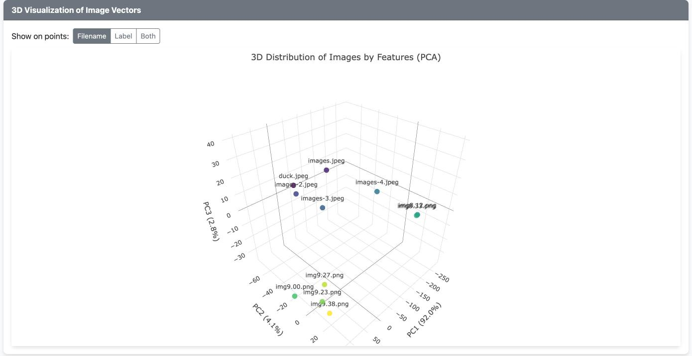
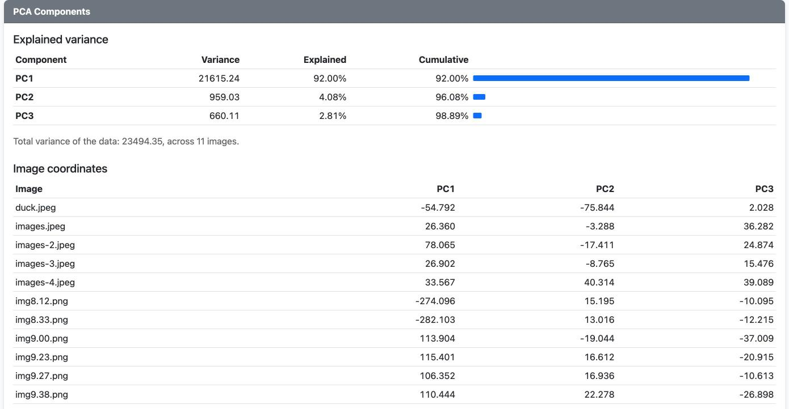

<!-- generated by tools/gen_tutorial_pages.py --tutorial pca from docs/site/tutorial-pca-src/*.md - edit there -->
# Build a PCA explorer

*A tutorial in one project: upload images, turn each into 54 numbers, and reduce them
to three with principal component analysis, drawn as a 3D plot with the component
values beside it. Two Maned programs do all of the computing, in integers only, behind
`maned-serve`; the page is plain HTML. Every program on this page is complete, and every
output was produced by running it.*



> **Want the code first?** The complete project is on GitHub:
> [tutorials/PCA-tutorial](https://github.com/FabianoDicheti/maned-lang-docs/tree/main/tutorials/PCA-tutorial).
> It needs Maned 0.4.3 or newer and nothing else: `sh serve.sh`, then open
> [localhost:8090](http://localhost:8090). This page is the why and the how of each file.

## What PCA does

Give every image a row of numbers, and a collection of images becomes a table: one row
per image, one column per measurement. Fifty-four columns are too many to look at, and
most of them move together: a bright image has high block means, a high histogram on
the right and a large first singular value, all at once. PCA finds the few directions
along which the rows actually differ, and re-expresses every row along them.

The recipe is short:

1. **Center** each column by subtracting its mean, so the cloud of rows sits at the
   origin.
2. **The covariance matrix** `C = XcᵀXc / (n−1)` says how each pair of columns varies
   together. It is symmetric, 54 × 54.
3. **Its eigenvectors** are the principal components: perpendicular unit directions,
   ordered by their **eigenvalues**, which are the variance of the data along each one.
4. **Explained variance** is each eigenvalue as a share of their sum, the total
   variance. On the example images the first component alone explains 91 %.
5. **Scores** are the rows projected onto the first few components: `Xc · V`. Three
   scores per image are its coordinates in the 3D plot.

An eigenvector's sign is arbitrary, since `−v` is as good a direction as `v`. Like
sklearn, this project makes the largest entry of each component positive, so the same
data always gives the same picture.

## What you build

| Part | Where | What |
|---|---|---|
| `features.mnd` | `maned-serve`, port 8090 | one `[128,128]` grayscale image in, its 54 numbers out |
| `pca.mnd` | `maned-serve`, port 8091 | every image's row in; scores, loadings and variances out |
| `web/index.html` | served by the first `maned-serve` | upload, grayscale and resize on a canvas, keep the images in IndexedDB, draw the plot |
| `check/check.sh` | your shell | both programs on stored images, against numpy's answers |

The first [part](#turning-an-image-into-54-numbers) builds the 54 numbers, the
[second](#the-principal-components) computes the components, the
[third](#serving-it-to-a-page) serves both to the page, and the
[last](#checking-it-against-numpy) checks the arithmetic.

## Run it

You need Maned 0.4.3 or newer: `maned-run --version` should say so. Then, in the
project folder:

```sh
sh serve.sh                 # then open http://localhost:8090 (exactly "localhost")
```

Upload three or more PNG or JPEG images. Each goes through `features.mnd` as it
arrives, and from the third on the rows go through `pca.mnd` and the plot and the PCA
Components card appear. Your images stay in your browser; nothing is stored on a
server.

The outputs on this page come from eleven example images. They are not in the published
project, but their 128 × 128 gray pixels are, in `check/expected.dqt`, which is what the
check runs on.

## Without floating point

Maned computes in int32, with decimals written as scaled integers, and every op either
gives the exact integer answer or refuses. That shapes the whole project:

- **The eigenvectors** come from `eigendecomp`, a cyclic Jacobi solver in fixed point
  with `__int128` intermediates. It never touches a float, so the same data gives the
  same bits on arm64 and x86_64.
- **The frequency features** use `fft2d` and `log`, both integer-only too.
- **Every product has a stated bound.** The comments in the programs give the largest
  value each step can reach, so it provably stays inside int32, and
  `maned-run --trap-overflow` confirms it on real images.

The answers still match numpy's to within rounding. The [last part](#checking-it-against-numpy)
shows how close.

## Turning an image into 54 numbers

`features.mnd` takes one grayscale image, `[128,128]` with values 0 to 255, and answers
one row of 54 numbers, each multiplied by 1000 so three decimals survive in integers:

| Columns | Feature | What it says about the image |
|---|---|---|
| 0–31 | intensity histogram, 32 bins, as a share of the pixels | how dark or light it is overall |
| 32–33 | Sobel gradient magnitude: mean and standard deviation | how much edge there is |
| 34–41 | four horizontal blocks: mean and standard deviation of each | where the light is, top to bottom |
| 42–51 | the top 10 singular values, over the sum of all of them | how simple its structure is |
| 52–53 | 20 ln\|DFT\|: mean of the low and of the high frequencies | smooth or busy |

The program runs once per image, as a service. Its header and inputs:

```mnd
mnd::quantmax=2000000000;
mnd::quantmin=-2000000000;
mnd::quantres=0;

in::gray = csv();                           # [128,128], values 0..255
in::kx = [[[[-1,0,1],[-2,0,2],[-1,0,1]]]];  # conv2d weight: [Cout,Cin,KH,KW]
in::ky = [[[[-1,-2,-1],[0,0,0],[1,2,1]]]];
```

`in::gray = csv()` names the input without a file: under `maned-serve`, the request
body supplies it. `quantres=0` means the numbers are plain integers.

### The histogram without a loop

Maned has no loops and no branches, so the histogram is matrix products. Every pixel is
compared with every threshold `0, 8, 16, …, 256` in one `[16384,33]` comparison, and a
column sum counts the pixels at or above each threshold. A bin is the difference of two
neighbouring counts, which one matrix product computes for all 32 bins:

```mnd
    # ---- histogram -----------------------------------------------------------
    # cum[i] = pixels >= 8i, one compare of every pixel against every threshold,
    # so a bin is cum[i] - cum[i+1].
    gray {rows: -1, cols: 1} reshape px =
    33 range ids = ; ids 8 mul t0 =
    t0 {rows: 1, cols: -1} reshape t =
    1 33 ones row33 =
    px dup == col16k =
    px row33 matmul pxrep =
    col16k t matmul thrs =
    pxrep thrs >= reached =
    reached {axis: 0} tensor_sum cum =      # [1,33]
    32 eye i32 =
    1 32 zeros z32 =
    i32 z32 {axis: 0} concat upper =
    z32 i32 {axis: 0} concat lower =
    upper lower elemwise_sub bins =
    cum bins matmul counts =                # [1,32]
    counts 1000 mul ck = ; ck 8192 add ckr = ; ckr 16384 div hist =
```

### Edges, with the border cv2 uses

The Sobel filters are a `conv2d`. cv2 pads the border by reflection, so row −1 reads row
1; here that padding is a `[130,128]` selection matrix built from an identity, applied
on both sides. Built in the program, it needs no table file:

```mnd
    # ---- Sobel gradient ------------------------------------------------------
    # Reflect-101 padding, cv2's default border: row -1 reads row 1, and row 128
    # reads row 126. So [130,130] -> conv2d -> exactly [128,128].
    128 eye i128 =
    i128 {axis: 0, index: 1} slice e1 =
    i128 {axis: 0, index: 126} slice e126 =
    e1 {rows: 1, cols: -1} reshape first =
    e126 {rows: 1, cols: -1} reshape last =
    first i128 {axis: 0} concat pad0 =
    pad0 last {axis: 0} concat pad =        # [130,128]
    pad gray matmul padded0 =
    pad transpose padt =
    padded0 padt matmul padded =            # [130,130]
    padded kx {stride: 1, padding: 0} conv2d gx3 =
    padded ky {stride: 1, padding: 0} conv2d gy3 =
    gx3 {axis: 0, index: 0} slice gx =
    gy3 {axis: 0, index: 0} slice gy =
    gx dup elemwise_mul gx2 =
    gy dup elemwise_mul gy2 =
    gx2 gy2 elemwise_add g2 =               # <= 2 * 1020^2 = 2.08e6
    g2 1024 mul g2s =                       # <= 2.13e9
    g2s sqrt mag32 =                        # scale 32, <= 46000
    mag32 32 mul mag1k =                    # scale 1024
    mag1k tensor_mean m1k =
    m1k 125 mul gm0 = ; gm0 128 div gmean = ; gmean diag gmean11 =   # 1000/1024
    m1k 32 div m32 =
    mag32 m32 stdev s32 =
    s32 125 mul gs0 = ; gs0 4 div gstd = ; gstd diag gstd11 =        # 1000/32
```

The comments carry the bounds: the squared gradients reach 2.08e6, scaled by 1024 they
reach 2.13e9, just inside int32, and the square root brings them back to scale 32.

### Four blocks

`split` cuts the image into four horizontal blocks, and a small helper flow returns the
mean and the standard deviation of each:

```mnd
    # ---- four horizontal blocks ----------------------------------------------
    gray {axis: 0, sections: 4, index: 0} split b0 =
    gray {axis: 0, sections: 4, index: 1} split b1 =
    gray {axis: 0, sections: 4, index: 2} split b2 =
    gray {axis: 0, sections: 4, index: 3} split b3 =
    b0 block_stats st0 =
    b1 block_stats st1 =
    b2 block_stats st2 =
    b3 block_stats st3 =
```

### Singular values, through eigenvalues

The singular values of an image `A` are the square roots of the eigenvalues of `AᵀA`.
`eigendecomp` gives all 128 of them, largest first, so the sum of every singular value,
which the normalization needs, is exact:

```mnd
    # ---- singular values -----------------------------------------------------
    # sigma_k = sqrt(eigenvalue k of A^T A). Having all 128 is what allows the
    # normalization used here, the sum of every singular value.
    gray transpose grayt =
    grayt gray matmul ata =                 # <= 128 * 65025 = 8.3e6
    ata eigendecomp eigs =                  # [128,1], largest first, <= 1.07e9
    eigs {lo: 0, hi: 2000000000} clip eigp = # a rounded zero can land just below it
    eigp sqrt sigma =
    sigma tensor_sum sigma_sum =            # <= 128 * 32640
    10 eye i10 = ; 10 118 zeros z118 =
    i10 z118 {axis: 1} concat top10 =
    top10 sigma matmul sv0 =                # [10,1]
    sv0 1000 mul svk =
    svk sigma_sum divt svq =
    svq transpose svs =                     # [1,10]
```

### Frequency

`fft2d` is the 2-D discrete Fourier transform, with numpy's bin order. `{part: 2}` asks
for the magnitude of each bin, and `{scale: 256}` keeps eight more bits of it, because
the logarithm moves fastest on the small bins. `log` then gives `20 ln|X|`. numpy's
`fftshift`, which moves the zero frequency to the middle, becomes two selection
matrices: the low frequencies are the bins that wrap around index 0, the high ones the
bins around 64.

```mnd
    # ---- frequency -----------------------------------------------------------
    # 20 ln|X| * 1000. Reading |X| at scale 256 keeps the digits of the small bins,
    # where the logarithm moves fastest, and 20000 ln 256 = 110904 takes it back
    # out. A bin of exactly 0 has no log, so it reads as the smallest step, 1/256.
    gray {part: 2, scale: 256} fft2d mag =  # <= 256 * 128^2 * 255 = 1.07e9
    mag {lo: 1, hi: 2000000000} clip magp =
    magp {scale: 20000} log ln256 =         # <= 20000 ln 1.07e9 = 416000
    ln256 110904 sub lnv =

    # fft2d leaves DC at [0,0], so numpy's fftshift is two index ranges. The
    # central 20 bins, for low, wrap around: 118..127 then 0..9. Its four 10x10
    # corners, for high, meet at the middle: 54..73.
    z118 i10 {axis: 1} concat bottom10 =
    top10 bottom10 {axis: 0} concat lowsel = # [20,128]
    20 54 zeros z54 = ; 20 eye i20 =
    z54 i20 {axis: 1} concat mid0 =
    mid0 z54 {axis: 1} concat highsel =     # [20,128]
    lowsel lnv matmul low0 = ; lowsel transpose lowt = ; low0 lowt matmul lowb =
    highsel lnv matmul high0 = ; highsel transpose hight = ; high0 hight matmul highb =
    lowb tensor_mean lowm = ; lowm diag low =
    highb tensor_mean highm = ; highm diag high =
```

A bin of exactly 0 has no logarithm, so `clip` floors it at the smallest step, 1/256.
numpy returns minus infinity there, which breaks every later step.

### One image, start to finish

The row is the groups joined in order. Run it on the first example image:

```sh
maned-run features.mnd --in gray=128x128:...    # the 16384 pixel values
```

```text
flow 'features' outputs:
row : [1x54] = [3, 3, 4, 4, 4, 5, 5, 4, 4, 5, 8, 9, 15, 19, 50, 74, 85, 79, 76, 69, 42, 45, 68, 78, 78, 86, 75, 2, 0, 0, 0, 0, 49002, 94718, 180503, 3 …
out::row -> row.csv
```

Histogram shares come first (0.003 is 0.3 % of the pixels), then the gradient (49.0 and
94.7), the block means and spreads, the ten singular-value shares, and the two
frequency means, 187.6 and 103.9.

## The principal components

With a row per image, the PCA itself is one definition:

```mnd
# ============================================================================
# pca.mnd -- PCA to 3 components
# ----------------------------------------------------------------------------
# In:  x [n,54], one image per row, the features of features.mnd.
# Out: scores   [n,3]   each image's PC1, PC2, PC3 (what the 3D plot draws)
#      loadings [54,3]  each component as a unit vector over the features
#      variance [3,1]   variance along each component
#      explained [3,1]  the percentage of all the variance it holds
#      total    [1]     the variance of all the data
#
# The same recipe as sklearn's PCA: center only (no scaling per feature), the
# eigenvectors of the covariance, each signed so its largest loading is positive.
# It is integer-only inside, and the values are decimals with 3 places at the edge.
#
# SERVE: maned-serve pca.mnd --port 8091   (run from this folder)
# ASK:   curl -X POST localhost:8091/run.json -d '{"x": [[...54 values...], ...]}'
# ============================================================================
mnd::quantmax=2000000;
mnd::quantmin=-2000000;
mnd::quantres=3;

in::x = csv();

calc::ml::pca fit(x) {
    components: 3
} return model, scores, loadings, variance, explained, total;

out::scores = csv("scores.csv");
out::loadings = csv("loadings.csv");
out::variance = csv("variance.csv");
out::explained = csv("explained.csv");
out::total = csv("total.csv");
```

`calc::ml::pca` centers the columns, builds the covariance, solves it and projects.
`components: 3` keeps three. The return list is positional: any prefix of
`model, scores, loadings, variance, explained, total`, in that order. Naming the third
one `variance` would not make it the variance; it would still be the loadings.

`quantres=3` puts three decimals in every integer, which is how the page sends the
features: `1.000` travels as 1000. The large `quantmax` leaves room for variances in the
tens of thousands.

### What comes out

On the eleven example images:

```text
flow 'fit' outputs:
model : [231] = [1296974925, 1, 9, 3, 54, 3, 0, 223, -747, -1803, -89310, -1463985, -342252, -139356, -67115, -61979, -53043, -46926, -42913, -35388,  …
scores : [11x3] = [-53694, -78804, -4568, 78235, -24044, 22475, 27389, -10998, 13529, 32600, 41990, 41572, 27318, -13321, 35356, -273712, 20991, -7496 …
loadings : [54x3] = [0, 0, 0, 0, 0, 0, 0, 0, 0, -1, 2, -2, 0, 0, 0, 0, 0, 0, 0, 0, 0, 0, 0, 0, 0, 0, 0, 0, 0, 0, 0, 0, 0, 0, 0, 0, 0, 0, 0, 0, 0, 0, 0 …
variance : [3x1] = [21573975, 1139338, 625539]
explained : [3x1] = [91422, 4828, 2651]
total : [1] = [23598240]
out::scores -> scores.csv
out::loadings -> loadings.csv
out::variance -> variance.csv
out::explained -> explained.csv
out::total -> total.csv
```

Read it at three decimals:

- **`variance`** is the eigenvalue of each component: 21573.975, 1139.338 and 625.539.
- **`explained`** is each one as a share of `total`: 91.422 %, 4.828 % and 2.651 %. Three
  components keep 98.9 % of how the images differ.
- **`scores`** are the coordinates, three per image, in the plot's units.
- **`loadings`** are the components themselves, one column of 54 per component. The
  largest entries say what a component measures.
- **`model`** is everything `ml_predict` needs to place a new image without refitting:
  the components, the means, and the variances. It can be saved with
  `out::model = model("pca.mnm")`.

In the browser the same images give slightly different numbers, 92.00 % for PC1,
because the page resizes them on a canvas and the canvas gives slightly different
pixels than the stored copies the outputs above come from. Each answer is right for
its own pixels:



### What the first component means

On these images PC1's largest loadings are the four block means, about 0.5 each: the
first component is overall brightness, and it explains 91 % because brightness is what
varies most. PC2 is mostly the gradient's mean and spread, how much edge an image has.
The histogram and singular-value features barely count, because they sit between 0 and
1 beside means up to 255.

That is what center-only PCA does, here and in sklearn: the features with the largest
numbers dominate. When the units are not comparable, standardize first:

```mnd
calc::ml::pca fit(x) {
    components: 3,
    standardize: true
} return model, scores, loadings, variance, explained, total;
```

Each column is then divided by its standard deviation before the covariance, so every
feature counts the same.

### How the eigenvectors are found without floats

The covariance is never rounded. `calc::ml::pca` computes `n·Σxxᵀ − ΣxΣxᵀ` in
128-bit integers, which is exactly `n(n−1)` times the covariance, so the centering costs
no precision. The solver behind `eigendecomp` then runs cyclic Jacobi rotations: each
one zeroes an off-diagonal pair with a rotation whose cosine and sine are computed with
an integer square root, in 62-bit fixed point. When every off-diagonal entry is within a
few units of the last bit, the diagonal holds the eigenvalues and the accumulated
rotations hold the eigenvectors.

Nothing in that path depends on the processor's floating point, so the answer is the
same bits on any machine. The eigenvalues match numpy on every printed digit.

## Serving it to a page

`maned-serve` runs one program as an HTTP service: `POST /run.json` with the program's
inputs as JSON, and the outputs come back as JSON. Each process serves one program, so
the project runs two:

```sh
#!/bin/sh
# Start the backend: two maned-serve processes, one script each, and the page.
#   features.mnd on :8090, which also serves web/
#   pca.mnd      on :8091, which the page reaches by CORS
#
#   sh serve.sh                 then open http://localhost:8090
#
# maned-serve is taken from $MANED_SERVE, then this workspace, then PATH. It needs
# Maned 0.4.3 or newer, for --static and --cors. A browser keeps connections open, and each one
# holds a worker, hence --workers.
set -e
cd "$(dirname "$0")"

MANED_SERVE="${MANED_SERVE:-}"
if [ -z "$MANED_SERVE" ]; then
  if [ -x ../../../maned-serve ]; then MANED_SERVE=../../../maned-serve
  else MANED_SERVE=maned-serve; fi
fi

"$MANED_SERVE" features.mnd --port 8090 --workers 8 --static web &
FEATURES=$!
"$MANED_SERVE" pca.mnd --port 8091 --workers 8 --cors http://localhost:8090 &
PCA=$!
trap 'kill "$FEATURES" "$PCA" 2>/dev/null' INT TERM EXIT

echo "open http://localhost:8090"
wait
```

- **`--static web`** makes the features server also serve the page and its images, so
  the browser loads everything from [localhost:8090](http://localhost:8090).
- **`--cors http://localhost:8090`** lets that page call the PCA server on another port.
  A browser blocks a request to a different origin unless the server allows it.
- **`--workers 8`**, because a browser keeps connections open and each one holds a
  worker.

### The two requests

The page sends each image as its 16384 gray values:

```sh
curl -s localhost:8090/run.json -d '{"gray": [[...], ... 128 rows ...]}'
```

```text
{"outputs":{"row":[[3,3,4,4,4,5,5,4,4,5,8,9,15,19,50,74,85,79,76,69,42,45,68,78,78,86,75,2,0,0,0,0,49002,94718,180503,36062,173963,41703,139779,39875, …
```

Then every stored row, divided by 1000 so it reads as decimals, goes to the PCA server in
one request:

```sh
curl -s localhost:8091/run.json -d '{"x": [[0.003, 0.003, ...], ... one row per image ...]}'
```

```text
{"outputs":{"scores":[[-53.694,-78.804,-4.568],[78.235,-24.044,22.475],[27.389,-10.998,13.529],[32.600,41.990,41.572],[27.318,-13.321,35.356],[-273.71 …
```

Inputs and outputs are decoded at the program's `quantres`, so the page reads `-53.694`
where the program computed `-53694`.

### The browser's half

Maned has no resize op and keeps nothing between requests, so the page does two jobs
itself. It turns an upload into the `[128,128]` grayscale the program expects, on a
canvas:

```text
        async function imageToGray(blob) {
            const bitmap = await createImageBitmap(blob);
            const canvas = document.createElement('canvas');
            canvas.width = IMAGE_SIZE;
            canvas.height = IMAGE_SIZE;
            const context = canvas.getContext('2d', { willReadFrequently: true });
            context.fillStyle = 'black';
            context.fillRect(0, 0, IMAGE_SIZE, IMAGE_SIZE);
            context.imageSmoothingQuality = 'high';
            context.drawImage(bitmap, 0, 0, IMAGE_SIZE, IMAGE_SIZE);
            bitmap.close();

            const pixels = context.getImageData(0, 0, IMAGE_SIZE, IMAGE_SIZE);
            const gray = [];
            for (let y = 0; y < IMAGE_SIZE; y++) {
                const row = [];
                for (let x = 0; x < IMAGE_SIZE; x++) {
                    const i = (y * IMAGE_SIZE + x) * 4;
                    const value = Math.round(0.299 * pixels.data[i] + 0.587 * pixels.data[i + 1] + 0.114 * pixels.data[i + 2]);
                    row.push(value);
                    pixels.data[i] = pixels.data[i + 1] = pixels.data[i + 2] = value;
                    pixels.data[i + 3] = 255;
                }
                gray.push(row);
            }
            context.putImageData(pixels, 0, 0);
            return { gray, processedUrl: canvas.toDataURL('image/png') };
        }

        // Run features.mnd on a stored image and keep the answer with it
```

and it keeps every image, label and feature row in IndexedDB, so they survive a reload
and belong to this browser only. Whenever the set of images changes, it asks for the
components again and draws them:

```text
        async function updatePlot3D() {
            try {
                const records = (await imageStore.all()).filter(record => record.vector);
                if (records.length < MIN_IMAGES) {
                    pcaResult = null;
                    plotVectors = [];
                    pcaMessage = `Add at least ${MIN_IMAGES} images to see the components (${records.length} so far).`;
                } else {
                    const outputs = await postJson(PCA_URL, { x: records.map(record => record.vector.map(v => v / 1000)) });
                    plotVectors = records.map((record, i) => ({
                        id: record.id,
                        filename: record.filename,
                        label: record.label,
                        pca_x: outputs.scores[i][0],
                        pca_y: outputs.scores[i][1],
                        pca_z: outputs.scores[i][2]
                    }));
                    pcaResult = {
                        loadings: outputs.loadings,
                        variance: outputs.variance.map(row => row[0]),
                        ratio: outputs.explained.map(row => row[0]),
                        total: outputs.total[0]
                    };
                    pcaMessage = '';
                }
            } catch (error) {
                console.error('Error loading 3D vectors:', error);
                pcaResult = null;
                plotVectors = [];
                pcaMessage = error.message;
            }
            renderPlot3D();
            renderComponents();
        }

        // Text shown for a point, depending on the selected label mode
```

The plot is Plotly's 3D scatter of the scores. The PCA Components card below it shows
the explained variance, every image's coordinates, and the largest loadings of each
component, with the feature names.

### Limits

- **At least three images,** because there are three components. With exactly three,
  PC3 reads 0 %: three points span only a plane.
- **The browser decides the pixels.** A canvas resize differs slightly from other
  resizers, so the same image can score a little differently elsewhere.
- **No authentication.** `maned-serve` binds to 127.0.0.1 unless told otherwise.

## Checking it against numpy

Integer arithmetic can be exactly right and still compute the wrong thing, so the
project carries a check that needs only `maned-run` and a shell:

```sh
sh check/check.sh           # exit status 0 only if every check passes
```

```text
worst : [1x54] = [0, 0, 0, 0, 0, 0, 0, 0, 0, 0, 0, 0, 0, 0, 0, 0, 0, 0, 0, 0, 0, 0, 0, 0, 0, 0, 0, 0, 0, 0, 0, 0, 2, 14, 1, 7, 1, 7, 1, 8, 1, 8, 1, 1, …
ok    features match numpy
ok    fft2d keeps each image's energy
e_scores : [1] = [13]
e_loadings : [1] = [0]
e_variance : [1] = [36]
e_explained : [1] = [0]
e_total : [1] = [9]
e_orthonormal : [1] = [1]
e_diagonal : [1] = [12922]
e_off : [1] = [2071]
explained_sum : [1] = [98901]
ok    PCA matches numpy, and obeys what any PCA must
RESULT: all checks passed
```

It runs both programs on the eleven example images, stored as gray pixels in
`check/expected.dqt`, and checks three things.

### Against numpy

`check/expected.dqt` and `check/expected_pca.dqt` hold numpy's answers: the same 54
features and sklearn's PCA, computed in floating point by an independent
implementation. Maned's output is compared with them, feature by feature:

```mnd
# The 54 features of 11 images against numpy's, both as integers x1000. Run by check.sh.
# Each allowance is the group's measured error plus a little: rounding in numpy's own
# x1000, and the integer means and square roots in features.mnd.
mnd::quantmax=2000000000;
mnd::quantmin=-2000000000;
mnd::quantres=0;

in::got = csv("got_features.csv");
in::want = dqt("expected.dqt", "features");

calc::lambda_flow check(got, want) {
    got want elemwise_sub d =
    d abs a =
    a {axis: 0} tensor_max worst0 =
    worst0 {rows: 1, cols: 54} reshape worst =
    1 32 1 full hist =                       # histogram
    1 2 16 full grad =                       # gradient
    1 8 10 full blocks =                     # blocks
    1 10 2 full sv =                         # singular values
    1 2 3 full freq =                        # frequency
    hist grad {axis: 1} concat t1 =
    t1 blocks {axis: 1} concat t2 =
    t2 sv {axis: 1} concat t3 =
    t3 freq {axis: 1} concat allowed =
    worst allowed > above =
    above tensor_sum fails =
} return worst, fails;

out::fails = csv("fails.csv");
```

`worst` is the largest error of each feature over the eleven images, in thousandths. The
histogram matches exactly, and the largest error is 0.014, on the gradient's spread,
where the integer square roots truncate. Each allowance is the measured error plus a little,
so a change that moves any feature further fails the check.

The expected values must come from somewhere other than Maned. Values captured from
Maned's own output would only show that nothing changed, not that it was right.

### What any PCA must obey

Some checks need no reference at all, because they hold for every correct PCA:

- **The loadings are orthonormal:** `LᵀL` is the identity.
- **The scores are uncorrelated,** and each column's variance is its component's
  variance: `SᵀS = (n−1)·diag(variance)`.
- **The explained percentages don't pass 100.**

```mnd
    # ---- loadings are orthonormal: L^T L = I, at scale 10^6 from the matmul -----
    loadings transpose lt =
    lt loadings matmul ltl0 =
    ltl0 1000 div ltl =
    3 eye i3 =
    i3 1000 mul ik =
    ltl ik worst e_orthonormal =

    # ---- scores are uncorrelated, each with its component's variance ------------
    # S^T S = (n-1) * diag(variance). S/100 keeps the products inside int32, which
    # with n = 11 makes both sides the same raw number.
    scores 100 div s =
    s transpose st =
    st s matmul sts =
    sts i3 elemwise_mul on =
    sts on elemwise_sub off =
    1 3 ones row3 =
    row3 on matmul diag_row =
    diag_row transpose got_variance =
    got_variance variance worst e_diagonal =
    off abs off_abs =
    off_abs tensor_max e_off =

    # ---- explained variance can't pass 100 % ------------------------------------
    explained tensor_sum explained_sum =
```

### Parseval

A Fourier transform keeps a signal's energy: the mean squared magnitude of the bins is
`h·w` times the mean squared pixel. `check_fft.mnd` checks that on every image, again
with no reference:

```mnd
calc::lambda_flow check(gray) {
    gray tensor_mean m =
    gray dup == unit =
    unit m scalar_mul spread =
    gray spread elemwise_sub x =
    x {part: 2} fft2d mag =
    mag 64 div small =
    small dup elemwise_mul small2 =
    small2 tensor_mean energy_x =
    x dup elemwise_mul x2 =
    x2 tensor_mean energy_img0 =
    energy_img0 4 mul energy_img =
    energy_x energy_img elemwise_sub gap0 =
    gap0 abs gap =
    gap 100 mul gap100 =
    gap100 energy_img elemwise_div percent =
    percent 3 > above =
    above tensor_sum fails =
} return percent, fails;
```

### A check is only worth what it catches

Each check was also run against deliberately broken copies, and each one failed: a
wrong logarithm offset in `features.mnd`, the wrong frequency bins, an energy formula
off by 25 %, a standardized PCA where a plain one was expected, and every PCA allowance
lowered below its measured error.

### What the numbers say

On the eleven examples, against numpy:

| Features | Max error | Value range |
|---|---|---|
| Histogram | 0.0005 | 0..0.69 |
| Gradient | 0.014 | 49..163 |
| Blocks | 0.008 | 16..241 |
| Singular values | 0.001 | 0.01..0.71 |
| Frequency | 0.0014 | 104..195 |

| | Explained, Maned / numpy | Variance, Maned / numpy |
|---|---|---|
| PC1 | 91.42 % / 91.42 % | 21573.97 / 21573.99 |
| PC2 | 4.83 % / 4.83 % | 1139.34 / 1139.30 |
| PC3 | 2.65 % / 2.65 % | 625.54 / 625.57 |

The components point the same way as numpy's (`|cos|` 1.00000 for all three), and the
small variance gaps are the features' own rounding: given the same features, the
variances agree on every printed digit.
