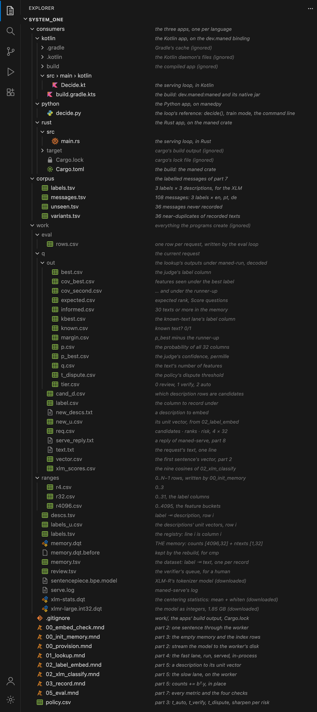
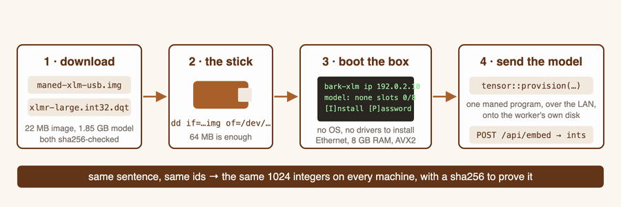
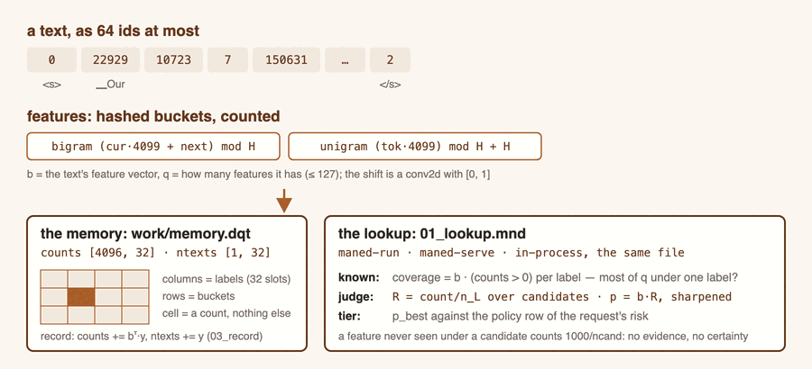
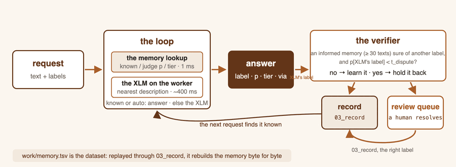
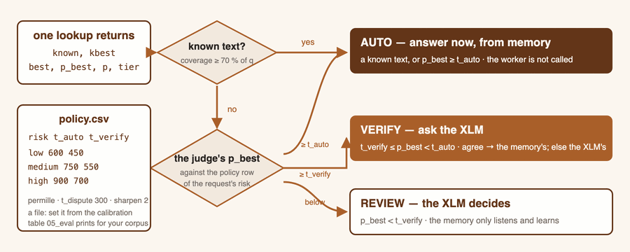

<!-- generated by tools/gen_tutorial_pages.py from docs/site/tutorial-src/*.md - edit there -->
# Build a System One

*A step-by-step tutorial: from a spare computer and a USB stick to a
decision service your Python, Kotlin or Rust app runs in-process, which
answers a classification question in a few milliseconds from its own
memory and learns from an XLM-RoBERTa worker on your LAN. Every program on
this page is complete, every output was produced by running it. Nothing
leaves your network. The project is nine Maned programs, a policy file, a
corpus and three apps; the steps between them are commands you type.*


> **Too long, want the code?** The complete project, deployable from
> zero, is on GitHub:
> [tutorials/system-one-tutorial](https://github.com/FabianoDicheti/maned-lang-docs/tree/main/tutorials/system-one-tutorial) —
> all three languages in one folder, with a README of the seven commands
> from a fresh worker to a running service. Prefer just yours? Each
> language has its own copy:
> [system-one-python](https://github.com/FabianoDicheti/maned-lang-docs/tree/main/tutorials/system-one-python),
> [system-one-rust](https://github.com/FabianoDicheti/maned-lang-docs/tree/main/tutorials/system-one-rust),
> [system-one-kotlin](https://github.com/FabianoDicheti/maned-lang-docs/tree/main/tutorials/system-one-kotlin).
> And if you would rather have it set up for you,
> [system-one-setup-agent](https://github.com/FabianoDicheti/maned-lang-docs/tree/main/tutorials/system-one-setup-agent)
> is a Claude Code assistant: clone it, run `claude`, type `/setup`, and it
> walks you through the whole deployment in the language you choose. This
> page is the why and the how of each file in the project.

## What a System One is

Kahneman's *System 1* is the fast, automatic judgement; *System 2* the
slow, deliberate one. A **System One model**, in the sense the decision-
layer products use it, is the fast half built for software: a structured
question goes in (*which of these labels? yes or no? how severe, 1 to 5?*),
a typed answer with a probability comes out, in milliseconds, cheap enough
to call on every request, and the slow generalist is called only on
exception. Three things make it a System One rather than a classifier:

- **It is typed.** The answer is a label, a probability per label and a
  tier, consumed by code, never prose.
- **It knows what it does not know.** Below a confidence threshold it
  defers to the slow path instead of guessing, and the threshold depends
  on how much a wrong answer costs.
- **It is cheap by default.** The expensive model is the exception, not
  the loop.

This tutorial builds one in Maned. The fast half is a **memory**: a matrix
of counts, hashed token features per label, that is both a cache of every
text it has seen and a judge of texts it has not. The slow half is
**XLM-RoBERTa large**, running as integers on a bare-metal worker you set
up yourself from a USB stick. The memory learns from the worker's answers,
and checks them: when it is confident the worker is wrong, it holds the
answer back for a human.

## What you will build

| part | you end up with |
|---|---|
| [1. The worker machine](#1-the-worker-machine) | a spare x86 computer booted from a stick, no operating system, serving on your LAN |
| [2. The model on the worker](#2-the-model-on-the-worker) | XLM-R large provisioned onto its disk from one Maned program; your first sentence embedded |
| [3. The project skeleton](#3-the-project-skeleton) | the folder, the policy file and an empty memory, all at one fixed point |
| [4. The fast lane](#4-the-fast-lane) | one lookup program: the known-text check, the judge, the tier, in milliseconds, served as it is |
| [5. The slow lane and learning](#5-the-slow-lane-and-learning) | the XLM classification, the record that is one outer product, the text file that is the dataset |
| [6. The loop, the tiers, the verifier](#6-the-loop-the-tiers-the-verifier) | the app that is the loop: memory first, the XLM when the policy asks, the review queue, three kinds of question |
| [7. Measure it](#7-measure-it) | 288 requests over four passes, every metric and a calibration table computed in Maned, the rebuild proof |
| [8. The service and the apps](#8-the-service-and-the-apps) | the lookup resident in `maned-serve`, and the same program in-process in Python, Kotlin and Rust |

All of it lives in one folder, [the one on GitHub](https://github.com/FabianoDicheti/maned-lang-docs/tree/main/tutorials/system-one-tutorial). This is the
finished project as VS Code shows it, every folder open: the programs,
the policy and the corpus appear in full on this page, the apps are
summarised in part 8 and read whole in the repository, and in grey are
the files the programs create under `work/`, the apps' build output and
`Cargo.lock`, which git ignores. The `.mnd` and `.dqt` icons come with the
Maned extension.



## What it does, measured

The numbers below come from part 7, run on the project as published here
(the worker is a 4-core AVX2 desktop). Three labels, *urgent* / *later* /
*careful*, messages in English, Portuguese and German.

- **A text it has seen is a cache hit.** 105 of 108 repeated texts were answered from memory, 103 of them as
  known, in 65 ms on average with a process start per request and 1 to
  2 ms in-process; the XLM path takes about 470 ms.
- **A text it has never seen gets a judgement.** On 36 new messages the
  judge's best label was right 69 % of the time, having learned only from
  the XLM's own labels (the XLM itself: 83 % on that pass, 67 % overall).
  The 8 it was confident enough to answer alone were all right.
- **It checks the slow path.** Over 288 requests the verifier disputed
  11 of the XLM's labels; the XLM was wrong in 8 of them.
- **It is exact.** Replaying the recorded texts rebuilds the memory byte
  for byte. Two workers given the same sentence return the same integers.

Part 7 shows the honest side too: while the memory is still filling, its
early confident answers are weak, and the zero-shot XLM is a mediocre
teacher. Both are visible in the numbers and both have a knob.

## What you need

| | |
|---|---|
| **Maned 0.4.2 or newer** | `maned-run` and `maned-serve` on your PATH: see [Install](install.html). The `spm()`, `embed()` and `tensor::provision` constructs used here arrived in 0.4.2. |
| **A second computer** | 64-bit x86, 8 GB of RAM, a SATA or NVMe disk, a wired Ethernet port (or a Realtek RTL8153 USB adapter). An old laptop or a mini PC is ideal. AVX2 makes it ten times faster. |
| **A USB stick** | 64 MB or more. It will be erased. |
| **Downloads** | the 24 MB worker image, the 1.85 GB model as integers, a 5 MB tokenizer model, 153 KB of statistics. Every file is checked against its sha256. |
| **Python 3 and `manedpy`** | the loop's reference app, which parts 6 and 7 run from the terminal; `pip install manedpy`, 0.4.2 or newer. |
| **For part 8** | the Kotlin or Rust binding too, if that is your language: `dev.maned:maned` on Maven Central, the `maned` crate on crates.io. See [Integration](bindings.html). |
| **An afternoon** | most of it waiting for the model to travel to the worker. |

Two rules hold throughout. **Credentials and addresses live in one file
outside every repository**, `~/.config/maned/xlm.env` with mode 600, and
the programs read them from the environment. **Everything that computes is
a `.mnd` program**: the terminal and the apps do strings, files, processes
and the wall clock, nothing else. When a page shows a number, a program printed
it.

## 1. The worker machine

*A spare
computer becomes the XLM-R worker: write one image to a USB stick, boot the
computer from it, read its screen, give it an identity, install it to the
disk. No operating system, no drivers, no Python on that machine. Part 2
puts the model on it.*



The worker runs the `maned-xlm` kernel: a sibling of the general Bark
worker described in [Set up a Bark machine](bark-machines.html) that boots,
loads XLM-RoBERTa large from an integer `.dqt` file on its own disk and
serves `POST /api/embed`. The model is integers end to end: int32 weights
and activations, int64 accumulators, one rounding rule, no floating point
at inference. The same ids give **byte-identical vectors on every
machine**, and every reply carries a sha256 so the client can prove it.

### 1. What you need

**The worker** (the computer that will run the model):

| | minimum | notes |
|---|---|---|
| CPU | 64-bit x86 (Intel or AMD) | AVX2 makes it about ten times faster; without AVX2 it still works, slowly, and the screen says so |
| RAM | 8 GB | the model needs 5078 MiB above the 4 GiB line; a 6 GB machine fails the `memory` check |
| Disk | a SATA (AHCI) or NVMe disk with about 2 GB free, or one you can give up | the weights live on a partition; other partitions are left alone unless you choose otherwise |
| Ethernet | Realtek 8139/8168/8111 (most desktops), Intel e1000e family (82574, I217 to I219), virtio (any VM), or a Realtek RTL8153 USB adapter | **Wi-Fi is not supported.** A laptop without an Ethernet port needs the USB adapter |
| Firmware | BIOS or UEFI, Secure Boot **off** | the stick boots either way |
| Keyboard | USB or PS/2, plugged in before power-on | only needed for the install step and to read the log |

Proven so far: an Intel Ice Lake laptop (SATA, USB Ethernet), an AMD Zen 1
mini PC (NVMe, onboard Realtek), an AMD Zen 4 desktop, and QEMU/KVM with
virtio, e1000 and rtl8139 NICs.

**Your own computer**: Linux or macOS with `python3`, on the same LAN,
able to reach TCP port 4780 on the worker; Maned 0.4.2 or newer installed.

### 2. Write the stick

Download the image and its checksum file from the release page, and check
it first:

```sh
curl -fsSLO https://github.com/FabianoDicheti/maned/releases/latest/download/maned-xlm-usb.img
curl -fsSLO https://github.com/FabianoDicheti/maned/releases/latest/download/SHA256SUMS
shasum -a 256 -c SHA256SUMS --ignore-missing      # Linux: sha256sum -c SHA256SUMS --ignore-missing
```

The image is about 24 MB and boots on BIOS and on UEFI from the same file.
Then write it. **This erases the stick.** Find the right device name before
you type it; writing to the wrong disk destroys that disk.

Linux:

```sh
lsblk -d -o NAME,SIZE,MODEL        # find the stick, e.g. sdb
sudo umount /dev/sdb* 2>/dev/null  # if the desktop auto-mounted it
sudo dd if=maned-xlm-usb.img of=/dev/sdb bs=4M conv=fsync status=progress
sudo cmp -n $(stat -c %s maned-xlm-usb.img) maned-xlm-usb.img /dev/sdb && echo VERIFIED
```

macOS:

```sh
diskutil list                      # find the stick, e.g. disk4
diskutil unmountDisk /dev/disk4
sudo dd if=maned-xlm-usb.img of=/dev/rdisk4 bs=4m
sudo diskutil eject /dev/disk4
```

Windows: Rufus in **DD image** mode, or balenaEtcher, which always writes
byte for byte. Do not let any tool "fix" or reformat the image, and decline
when your desktop later offers to format the stick: it does not recognise
the partitions, and they are fine.

### 3. Boot the computer

1. Plug in the Ethernet cable and a keyboard. Insert the stick.
2. Power on and open the **one-time boot menu**. The key depends on the
   board: **F12** (Lenovo, Dell, many desktops), **F8** (ASUS), **F11**
   (MSI, Gigabyte), **Esc** (HP), **Option** (Intel Macs). The screen
   usually says which, briefly, at power-on.
3. Pick the USB stick. If the menu lists it twice, once with a `UEFI:`
   prefix and once without, either works: prefer the entry **without** it
   on an older board and the one **with** it on a recent one.
4. A GRUB menu appears for three seconds, then the kernel boots. Within a
   few seconds you see a status screen with a frame, a node panel and an
   `[ OPERATIONS ]` band.

If the computer ignores the stick and boots its usual system, go into the
firmware setup (usually **F2** or **Del** at power-on), turn **Secure Boot
off**, set any "boot mode" or "CSM" option to **UEFI and Legacy**, save,
and try the boot menu again. Nothing on the computer's disk is changed by
booting the stick.

### 4. Read the screen

The status screen is the worker's only local display. The parts you need:

- **The node panel** (top left): the alias, the CPU count, the tier
  (`avx2` or `scalar`), the RAM, and **the IP address**. The worker asks
  your router for an address with DHCP; it typically takes a few seconds
  after the link comes up. Write it down: every command from here on uses
  it. If the field stays empty, see step 8.
- **The `[ OPERATIONS ]` divider**: right after the word, the verdict. On a
  fresh stick it reads `NOT READY: weights`, which is correct: the model is
  not on this machine yet. Once provisioned, and after every boot, it reads
  `ready`.
- **Four keys**, listed at the bottom: `L` toggles between the status page
  and the kernel log, `I` opens the disk install page, `P` changes the
  credentials, `R` reboots. Press `L` once now: if the log page appears,
  the keyboard works; press `L` again to come back.

On a UEFI boot the screen is drawn in the top-left 640×400 pixels of the
monitor with black around it. That is normal.

The same information is one request away from your own computer:

```sh
curl -s http://192.0.2.10:4780/api/status | python3 -m json.tool
```

(`192.0.2.10` stands for your worker's address on every page of this
tutorial.) The `requirements` list shows ten checks, each with `ok`, a
`detail` and, when it fails, a `remedy`. `ready` is 1 only when every hard
check passes.

### 5. The identity

Every request to the worker carries a session token obtained with a user
name and a password; the alias is the name the screen shows. The prebuilt
image carries a generic identity: alias `maned-machine`, user `worker`,
password `12345`. Change it before the worker holds anything you care
about. Three ways:

1. **At the worker's keyboard**, after the install of step 6 (any option):
   press `P`, set alias, user and password. The page says
   `identity: persisted` when the new values survive a reboot (they are
   stored in an identity partition on the disk) and `not persisted` when
   they would not. Three wrong passwords lock the page for 60 s.
2. **For one boot, at the GRUB menu:** press `e` during the three-second
   menu, change `user=worker pass=12345` on the `multiboot2` line, press
   **F10** or **Ctrl-x** to boot. Nothing is written to the stick.
3. **Permanently on the stick:** build your own image with `USER=` and
   `PASS=` (the kernel's repository documents it).

An installed worker's own identity wins over the stick's: once you set
credentials with `P` on an installed machine, the stick's generic pair no
longer logs in there. If you forget the password: boot the stick, press `e`
at the GRUB menu, append ` nodisk` to the `multiboot2` line, press F10;
for that boot the on-disk identity is ignored, and `P` sets a new pair.

Now put the three values your computer needs in the one file every program
of this tutorial reads them from. It lives outside every repository, with
mode 600:

```sh
umask 077; mkdir -p ~/.config/maned
cat > ~/.config/maned/xlm.env <<'EOF'
export XLM_USER=worker
export XLM_PASS=12345
export S1_WORKER_HOST=192.0.2.10
EOF
```

> **Rule.** No program on these pages contains an address or a password.
> The `.mnd` programs read the login with `env("XLM_USER")` and
> `env("XLM_PASS")`, and the glue replaces the placeholder address with
> `$S1_WORKER_HOST` at run time. Keep it that way in your own project: a
> committed credential is the one mistake this setup cannot undo for you.

### 6. Make it permanent: install to the disk

Optional, but the shape you want for a machine that is only ever going to
be a worker. After this the computer boots the worker from its own disk, no
stick in it, straight to `ready`. The install is done at the worker's
keyboard, on purpose: nothing over the network can repartition a disk.

Press `I`. The page surveys the disk and offers numbered options, each
needing its own confirmation word typed in full, so a wrong key does
nothing:

| key | option | word | effect |
|---|---|---|---|
| `1` | install system, whole disk | `replace` | the disk becomes the worker's. Existing partitions are dropped from the table; their data is not overwritten but becomes unreachable |
| `2` | install system, free space | `install` | existing partitions are kept; the computer boots the worker instead of its old system until you remove it |
| `3` | identity only, free space | `identity` | nothing bootable is written; a 1 MiB partition stores the credentials you set with `P`, and the stick is still needed to boot |

For a dedicated worker, press `1`, type `replace`, Enter. The screen
reports `installed: bark system at lba ...` within seconds. Power the
machine off, remove the stick, power it on: it boots from the disk and,
once part 2 has put the model there, loads it (about 85 s on a laptop
SATA disk: read, sha256, decode, verify) and shows `ready`.

Note for UEFI-only boards: the disk install is a legacy boot record. A
board that cannot boot legacy from its disk needs the stick for every boot;
the stick itself boots on UEFI.

### 7. Check it from your computer

```sh
curl -s http://192.0.2.10:4780/health
curl -s http://192.0.2.10:4780/api/status | python3 -c 'import sys,json; s=json.load(sys.stdin); print(s["alias"], "ready" if s["ready"] else "not ready", [r["name"] for r in s["requirements"] if not r["ok"]])'
```

A fresh worker answers `not ready ['weights']`: the model is missing,
which is part 2's job. Everything else should be `ok`.

### 8. When something is wrong

The screen and `/api/status` say the same thing. Read the `[ OPERATIONS ]`
line first; when it says `NOT READY: <check>`, find the check here. The
`remedy` field of `/api/status` has the full text.

| it says | cause | what to do |
|---|---|---|
| `NOT READY: weights` | the model is not on this machine | part 2 |
| `NOT READY: memory` | not enough RAM above 4 GiB | the detail names the need (5078 MiB) and the have; 6 GB fails, 8 GB passes |
| `NOT READY: nic` | no supported Ethernet chip | a Realtek RTL8153 USB adapter, or a machine with Realtek or Intel e1000e Ethernet; Wi-Fi never works |
| `NOT READY: ip` | the NIC is up but DHCP did not answer | check the cable and the link light, give the router a few seconds, make sure the LAN has DHCP |
| `NOT READY: disk` | no AHCI or NVMe disk found | RAID mode in the firmware hides SATA disks: switch the controller to AHCI; some NVMe behind Intel VMD need VMD off |
| `NOT READY: acpi` | firmware tables not found: one CPU, no reset | rare; on UEFI the stick already passes the tables through GRUB |
| `NOT READY: timer` | the 8254 timer did not tick | some recent boards gate it when CSM is off; try the legacy boot entry |
| `scalar tier` | the CPU has no AVX2 | it works, about ten times slower |

Other situations: **no screen but the machine answers on the network**:
boot the other entry (with or without `UEFI:`); if there is none, the
worker is usable blind, everything but step 6 is done over the network.
**The keyboard does nothing**: press `L` first; a changing page proves the
keys arrive; a USB keyboard works through the firmware's emulation, and a
PS/2 one is the fallback for the install step. **The IP changed**: it
comes from DHCP and the screen shows the current one; give the worker a
fixed lease in your router. **A USB Ethernet adapter stops after a
software reboot**: power-cycle the machine; a cold boot always brings it
back.

The worker never writes to any disk except in part 2 (its own partition,
on your request) and step 6 (at your keyboard, after a typed word).
Everything else is read-only.

## 2. The model on the worker

*The worker from part 1 is booted and reachable but holds no model. Here
you download XLM-RoBERTa large as exact integers, send it to the worker's
disk with one Maned program, embed your first sentence, and fetch the
three small files the project needs next to it: the tokenizer model and
the centering statistics.*

### 1. The project folder

Everything from here on lives in one folder; make it now and keep every
command on this page relative to it. The programs read and write only
under `work/`, which is generated and disposable.

```sh
mkdir -p system_one/corpus system_one/consumers && cd system_one
```

Then source the env file of part 1 once in this shell: the four programs
that talk to the worker read its address and login from the environment,
through `env()` in their `device::` block, and never from a file in the
project.

```sh
. ~/.config/maned/xlm.env
```

There is no shell library to write. Every step on this page is a program
run as it is, and the files it reads are written by you, in the terminal,
with `printf`. A program prints each flow output as `name : [shape] =
[values]`, with the values as the raw integers of its fixed point: a
permille is `955`, a count is itself. That is the whole interface.

### 2. Download

Three files, two of them small. The tokenizer model is XLM-R's own, from
Hugging Face (MIT licence); the statistics and the model as integers are
release assets of Maned. Check every one against its sha256 before you go
on: the values are below, and the worker itself pins the model's.

```sh
mkdir -p work
HF=https://huggingface.co/FacebookAI/xlm-roberta-large/resolve/main
REL=https://github.com/FabianoDicheti/maned/releases/latest/download
curl -fsSLo work/sentencepiece.bpe.model $HF/sentencepiece.bpe.model
curl -fsSLo work/xlm-stats.dqt $REL/xlm-stats.dqt
curl -fsSLo work/xlmr-large.int32.dqt $REL/xlmr-large.int32.dqt     # 1.85 GB; only the provisioning needs it
shasum -a 256 work/sentencepiece.bpe.model work/xlm-stats.dqt work/xlmr-large.int32.dqt
```

```text
cfc8146abe2a0488e9e2a0c56de7952f7c11ab059eca145a0a727afce0db2865  work/sentencepiece.bpe.model
9a20130ca72b7ecacaf4cb71d3ead4ccbff654dc7779d77643e35723e02ca6ef  work/xlm-stats.dqt
d84e81a8da7b8898713d3a4861091c1961210a82b71f5fa99b9f8730ad5d9dd7  work/xlmr-large.int32.dqt
```

Why integers, and why that exact file: the checkpoint on Hugging Face is
`model.safetensors`, 2.2 GB of 16-bit floats. The worker runs no floating
point, so the weights are converted once to int32 at a decimal scale per
tensor, `v = round(f · 10^s)`, with the scales chosen by a quantizer that
measured the error against the float model (median cosine 0.99999999978 to
fp64 on its calibration set). The result is one `.dqt` file (the
[.dqt tensor files](dqt-tensors.html) page explains the container), whose
sha256 `d84e81a8…` is pinned by every tool and by the worker itself: a
corrupt file is refused rather than served. You can rebuild that file from
the checkpoint with `tensor::quantize` and the published recipe; the
download is the same bytes.

### 3. Send the model to the worker

One Maned program streams the file to the worker, which writes it to a
partition of its own disk. The worker is the guard: the same file sent
again without `force` is received, hashed and declined with
`already-provisioned`, nothing written; a wrong sha256 is a 400 with the
disk untouched; a fresh worker answers `PASS`.

`00_provision.mnd`:

```mnd
# 00_provision.mnd -- send the model to the worker, from maned (tensor::provision)
#
#   ./00_provision.sh
#
# In order, all printed as notes: the file's sha256 is computed here while
# streaming; the worker's survey is fetched (its disk, the BARK DATA partition
# and its slots, or the extent it would create); then the 1.85 GB file is
# streamed as POST /api/provision with that sha256 (file-streamed body, 900 s
# deadline). The worker is the guard: the same file without force answers
# `already-provisioned` after receiving and hashing the whole body and writes
# nothing; a wrong sha is a 400 with the disk untouched; a fresh worker
# answers PASS. Every refusal is E036 with the worker's text.
#
# The address and the login come from the environment (~/.config/maned/xlm.env,
# sourced once per shell), never from this file.
mnd::quantmax = 2147483;
mnd::quantmin = -2147483;
mnd::quantres = 5;

device::worker {
    host = env("S1_WORKER_HOST");   # the worker's address, from the environment like the login
    port = 4780;
    user = env("XLM_USER");
    pass = env("XLM_PASS");
}

tensor::provision("worker", "work/xlmr-large.int32.dqt");
```

It needs no driver: `maned-run` prints the worker's notes and the
verdict itself, and exits non-zero on any refusal.

```sh
maned-run 00_provision.mnd
```

```text
note: tensor::provision(worker): work/xlmr-large.int32.dqt, 1851000132 bytes (1765 MiB), sha256 d84e81a8da7b8898713d3a4861091c1961210a82b71f5fa99b9f8730ad5d9dd7
note: tensor::provision(worker): disk WDS250G3X0C-00SJG0, present true, boot_from_disk true
note: tensor::provision(worker): pinned d84e81a8da7b, weights loaded, engine ready, resident 1/8
note: tensor::provision(worker): BARK DATA partition on WDS250G3X0C-00SJG0, 16384 MiB, slots used 1, fits true
note: tensor::provision(worker):   slot 0: d84e81a8da7b FacebookAI/xlm-roberta-large alias xlmr-large (pinned)
note: tensor::provision(worker): already provisioned - slot 0 holds d84e81a8da7b (the whole body was received and hashed; nothing written; force=1 rewrites in place)
provision: already-provisioned
```

The notes are the survey the worker returned before the body was sent:
its disk, whether it boots from it, the pinned model it holds, the `BARK
DATA` partition and its slots. This worker already held the file, so the
last line is `already-provisioned`; on yours it is `provision: PASS`, and
the screen's `[ OPERATIONS ]` line turns to `ready` once the model is
loaded (about 85 s from a laptop disk). The program's `quantres` is 5
because that is the worker's output scale; provisioning itself moves bytes
and does no arithmetic.

### 4. Your first sentence

Now the whole path, text to vector, in one program: `spm()` tokenizes the
sentence here with the checkpoint's SentencePiece model, `embed()` posts
the ids to the worker and verifies the reply against the sha256 the worker
computed over its own bytes.

`00_embed_check.mnd`:

```mnd
# 00_embed_check.mnd -- the first sentence through the worker: text in, vector out
#
#   ./00_embed_check.sh "Any sentence, in any of XLM-R's languages."
#
# spm() tokenizes work/q/text.txt here with the checkpoint's SentencePiece
# model (the native Unigram tokenizer: the same ids as the Hugging Face
# tokenizer); embed() sends the ids to the worker as POST /api/embed and
# verifies the 1024-int reply against the sha256 the worker computed over its
# own bytes. The vector is deterministic: the same sentence gives the same
# bytes on every worker, and the note prints the model and the time.
#
# quantres 5 is the worker's output scale, so the vector lands untouched and
# out::csv writes it at five decimals (3255 -> 0.03255). Nothing is computed
# here on purpose: a value of this vector is up to ~3 000 000 raw, so even
# its square overflows int32. Every program that does arithmetic on these
# vectors runs at quantres 3 (the value lands divided by 100) - the first
# fixed-point decision of the project, and part 3 of the tutorial.
mnd::quantmax = 2147483;
mnd::quantmin = -2147483;
mnd::quantres = 5;

device::worker {
    host = env("S1_WORKER_HOST");   # the worker's address, from the environment like the login
    port = 4780;
    user = env("XLM_USER");
    pass = env("XLM_PASS");
}

in::v = embed("worker", "work/q/text.txt", "work/sentencepiece.bpe.model");

calc::lambda_flow look(v) {
    v r =
} return r;

out::r = csv("work/q/vector.csv");
```

The program reads its sentence from a file, so write the file and run it:

```sh
mkdir -p work/q
printf 'The invoice is overdue, please pay today.\n' > work/q/text.txt
maned-run 00_embed_check.mnd
```

```text
note: embed(worker): 1 row(s), model d84e81a8da7b alias xlmr-large, worker scale 10^-5, 0 clamp(s), 273 ms/request mean
flow 'look' outputs:
r : [1x1024] = [3283, -8718, 8448, -5111, 7178, 3553, -2562, 19967, 3163, 4133, -799, -5882, -5396, -9415, -5580, -2090, -13202, 4065, 639, 8080, -1004, -3311, -100, -5993, 6547, 18656, -4673, -6764, -6285, -241, -10372, -2641, -3325, -3490, -6460, 1639, 594, -11030, -20494, 2687, 15764, -3825, 6766, -1460, 374, -3081, -7106, 16431, -18943, -8335, 7085, 5802, 2878, -902, -12859, 7109, -2062, -3631, -2387, -8953, 936, -25813, -15974, 6783, -1329, 6318, -5868, -1104, 13652, -13750, -4667, 7685, 2109, -5907, -2945, -12076, -3488, 2911, 18926, -959, 22854, -2320, 523, -15346, -780, 8935, 332, -2435, -2203, 5738, -1382, 7098, -5359, -4314, -3101, 1865, 8689, 9286, -11453, -1546, 121, 3864, -3849, -771, 1254, -6786, -8548, -2416, -6196, -3893, -3351, 7218, 4914, 6470, -1514, -3441, 11370, -7646, -6040, -15399, 6337, 11432, 2546, -780, 2991, 11336, -607, 10962, 2700, 539, 2163, -16011, 4394, -1846, 1250, 4476, -8075, 7321, -196, -3376, -5788, -4248, 4789, 5405, 5471, -9342, 8826, 5673, -1489, -6706, 2325, 14355, 6500, -5426, 1092, -3357, -11219, 6687, -238, -7342, -5221, 8765, -9592, -10334, -1704, 9167, -4356, 4938, -1477, 7701, -8063, 3856, -609, 972, -4754, 28607, 13305, -32882, 1689, -2751, 135, 1985, -3320, -1713, 5364, -14088, 1139, -8387, -2521, -3617, 3148, -8488, 4340, -980, 6278, -8382, 5496, -15451, -3643, -2782, -10207, -1652, 1272, 10314, -725, -1168, -1460, -7557, 2279, -12003, 849, -1322, -4963, 6704, -4853, 14375, 5201, 7481, -7424, 10803, 2233, -3651, -2863, 3114, 8848, -4168, -469, -7869, 2138, -3771, -3733, 2530, 9886, -768, -717, -2188, 11854, -1124, 6789, -5446, -5937, 7000, -9389, -596, 7292, -4159, -3743, 7594, 515, -4647, -10738, -1671, -10164, -1501, 1088, -2253, -2675, 1635, -3229, 5688, 3312, 7518, -12452, 13588, -665, 9409, -1397, 7016, 214, -7515, -2549, 3163, -7171, -2805, 2198, 1030, -4316, -14821, -3341, -3141, -7732, 5374, -12646, -3120, -1426, -10234, -17950, 4204, -2486, -4480, -11893, 12951, 25049, -913, 9217, -13175, 2725, -3007209, -1388, -528, -354, -5714, 834, -9913, -1194, -10152, -6169, -3603, 9569, -9292, -1919, 638, -6637, 4529, -8833, 2816, 8319, -777, -3868, 8885, -5710, -3824, 3250, 5614, 3468, -577, -6646, -14814, 508, 24202, -494, -3289, 7155, 10061, -8915, 9190, -5284, -3939, 4651, 6409, -6366, -4415, -13878, -3219, 10944, -13134, -2541, 14814, 9304, 9076, 7425, -13400, 10735, -2160, 9226, -13609, 12627, -2469, 9179, -3592, 8025, -1756, 79, 99, 12767, -619, -7916, 723, 238, 3483, 3419, 2198, -4221, -5243, -5865, 8539, -50153, -118, 10613, -2791, -1967, -784, -14305, -11490, -9384, -8544, 530577, -3957, -7405, 5179, 10428, 313, 5208, 893, 6433, -2546, -1248, -8768, 4247, -1771, 7058, -489, 261, 3402, 100190, -868, -5712, 11238, 33926, -4388, -6425, 5029, -2759, -5640, 842, -2882, -2995, -4496, 212, -750, 6319, -309, -1566, -7292, 5333, 10480, -962, -6230, 2498, 15527, 1975, 309, 5296, 5708, -2325, 2228, 6933, 289, -1936, -434, 6881, -1592, -6779, -2624, -2791, 5870, -5935, -17788, -2830, 7615, -3512, -3141, 5441, -7816, -6062, 686, -6094, 4361, -6190, -12634, -7458, 1056, -2602, 5471, -6716, 12002, 7581, -4076, -3188, 8462, 10923, 180, -6261, 11033, -8831, -4356, -10058, 638, -3333, 16459, 2322, -1071, -736, 9133, 5392, 6442, -2430, 3053, -768, -5232, 1189, -1046, -1845, -5477, -823, 2381, 6876, 3774, -7039, 723, 2727, -2502, 2829, 2564, 6001, 11370, -2731, 10332, 4580, -1471, -8437, 4515, 1246, -2138, -222, -2206, -4536, 13457, -6716, -1625, 5613, -3282, -3497, -11740, -5741, -5040, 2287, 12393, -1086, -279, -2779, 5401, -5524, -11057, -11660, -4201, -4751, -601, -16389, -4030, -5486, -1420, -5006, 318, -7183, 2107, 1075, -1643, 2589, 27641, 8614, 2143, 2075, -8151, -2516, -3252, 10475, 2752, 4475, -12878, -2006, -2921, 7018, -7841, 4490, -17186, -1549, -2804, 69, -8120, -252, -7036, -8643, 1078, -7634, -7676, -7410, 4193, 2361, -4360, 2756, 5936, 2434, -8315, -3521, 1020, 6957, -7842, 3138, 1074, 7309, 3770, -1123, 7998, -3907, 10467, -52, -297, -1950, 4651, -6888, -14120, 10130, 5583, -1320, -11525, -373, 1945, -3774, 3763, -8707, 7519, 7055, -9995, 3881, -5109, 24822, -10465, -391, -18613, -3793, -4144, -237, -2694, 3226, 1090, -1860, 676, -3129, 15738, 12442, -20326, -3257, -3731, 102, -7240, 5707, -5808, -5635, -76, -10573, -10674, -13078, -7770, -5109, 2424, 6411, -11557, 8023, 854, -11927, -9757, -11771, 7341, 11332, 6766, 11025, 2653, -5607, -2440, 488, 3103, -5400, 13294, -348, 2228, 653, -4219, -1851, 153, 1822, -450, 2994, 3549, 1788, -5180, 6286, 597, -12277, -9849, 333, -13209, 565, -10627, -6411, -8652, 4225, -2922, -3546, 2462, 432, -7135, -1236, -1881, 2525, 6466, 47, 12404, -426, -593, 12507, 1639, 17733, -6512, 3448, -3480, -8156, -10753, 10183, 3414, -972, -666, 7703, 775, -3109, -5548, 8431, -669, -663, -7333, 3156, 56, 7509, -2508, 4507, 75, -3743, -14901, 8307, -7048, -3212, -526, -461, -8561, 9004, -10392, -11515, -373, 4145, -14104, -4063, 2670, -985, -2486, -1789, 12475, -4485, -1261, -3286, -11825, -7097, -6648, 8418, 2295, -1773, 80, 3530, -5723, 3989, -483, -1254, 4915, -14925, 4356, 269, 2521, -3344, 1091, -6599, -192, 2953, -2188, -142, -3341, -5418, -5647, -13910, -13955, -49, 4717, -29450, 12846, -7900, 966, 12246, 3693, -13136, 5536, 1598, 1369, 62, -6165, -5645, 5183, -7568, -12750, 3462, -2812, -1459, -11237, -386, 2501, -2830, 1185, 1894, -4852, 22160, -3165, 4814, -8602, -852, -8497, -3202, -7873, 7665, 7303, -1228, -3424, -175, 2951, -4773, 413, -4206, -4984, -1245, -1655, 5339, -16854, -6791, -5242, -2622, -8060, 8698, 3627, 14053, 3070, 450, -3527, 5452, 7901, 3864, -1355, -21116, -7638, 755, -462, -18254, -4917, 1196, 2416, 10390, -10887, 9253, -2273, -5543, 3516, 804, -14867, -4075, 7079, -5230, -7932, -3781, 5701, 5910, -6269, 10468, 17168, 12038, -1155, -11231, -4077, 5699, -7763, 7012, 3506, 4348, -3428, -4034, -244, -1947, -95, -7747, -625, 1125, 11907, 496, -2557, 166, 4977, 436, 2477, -4471, -3102, -9092, 4811, 2428, 7608, 4361, 1733, -3467, -22797, -5048, -47699, -11169, -13364, -6694, -5122, 293, 2700, 1052, 3800, 3402, -4082, 6419, 1766, 8510, -175, -337, -9604, 11541, 2099, -5437, -8435, 2492, 2229, 17676, 2306, -6917, 3706, 242, -7568, -1619, -2763, -4358, 107, -5292, 3490, -3050, -5005, -5995, 1600, -2824, -9426, 47, -1992, -588, 6224, 10652, -6224, -3997, -5598, 7995, 412, 2700, 2156, -11897, 6200, -751, 5304, -10795, 1642, 2705, 6177, 2789, -718, -6410, -403, -8161, -5751, -3981, 5190, -2602, 6049, 16447, 8398, -1498, 2132, -2577, -3978, -474, -3531, 3543, -8936, 2653, -1888, -7415, 3508, 1342, -727, 11044, -618, -1894, -4931, -4414, -8099, 19257, -10413, 11225, -10949, 17045, 10834, -1640, -3805, -2804, -9540, 5937, -7409, -6211, -757, 1811, -21215, -5842, 5008, -6724, -7377, -3179, -7326, -7946, -1244, -9003, -3083, -7243, -15052]
out::r -> work/q/vector.csv
0.03283,-0.08718,0.08448,-0.05111,0.07178,0.03553,-0.02562,0.19967,0.031
```

A 1024-dimensional vector of integers at 10⁻⁵; the worker's note gives
its own time per request, about a quarter of a second. Run it twice: the values are
identical, and they are identical on any other worker. The comment in the
program is the first fixed-point lesson of the project: at this scale a
value can reach three million, and its square overflows a 32-bit integer,
so every program that does arithmetic on these vectors runs at
`quantres 3` instead, where the same value lands divided by 100.

### 5. The statistics

Raw XLM-R sentence vectors all point in nearly the same direction: the
cosine between two unrelated sentences is about 0.99 and says nothing. The
remedy is classical: subtract the corpus mean and whiten, that is, project
onto the 256 principal directions and scale each to unit variance. With
that, cross-lingual nearest-neighbour precision on a public benchmark goes
from 56 % to 96 %. The mean and the 256 whitening rows are statistics
computed once; the project applies them in Maned (part 5) and the worker's
bytes never change.

`work/xlm-stats.dqt` is those statistics as the programs read them: one
[.dqt](dqt-tensors.html) file with two tensors, `mean` (one row of 1024)
and `whiten` (256 rows of 1024), raw integers at the scales part 5
explains. They were fitted on 1 616 sentences in several languages,
through this same worker. As a `.dqt` it is 153 KB where the same numbers
as csv text were 1.6 MB, and it loads in 26 ms instead of 43, because
nothing is parsed; the results are the same integers either way. Fitting your
own, for a domain or languages of your own, is an offline step outside
this project: embed a thousand or more sentences with a program like
`00_embed_check.mnd`, compute the mean and the eigendecomposition of the
covariance with any numerical tool, write the two matrices as csv in the
same layout, and convert them once with a two-line Maned program
(`in::w = csv(...)`, `out::w = dqt("work/xlm-stats.dqt", "whiten")`). Maned has no eigensolver, and does not need one at run time:
the statistics are inputs, not computations.

## 3. The project skeleton

*The folder gets its risk policy and an empty memory. This is also where
the one design decision that makes everything else simple is taken: every
memory program runs at the same fixed point, and the memory is nothing but
counts.*



### 1. The shape of the memory

A text arrives as at most 64 token ids. Its **features** are the
transitions between consecutive ids, *(cur, next)*, and the single ids,
each hashed into a bucket:

- bigram bucket `(cur · 4099 + next) mod 2048`, in the first half of the
  matrix;
- unigram bucket `(tok · 4099) mod 2048 + 2048`, in the second half.

The memory is **one matrix of counts**, `counts [4096, 32]`, 32 columns
for 32 label slots (`work/labels.tsv` line *i* is column *i*), plus one
row `ntexts [1, 32]`, how many texts were recorded under each label. A
record adds a text's features to its label's column; a lookup reads the
counts and computes everything else from them, in a handful of matrix
products: no logarithm, no loop, nothing to train, and nothing to keep
consistent, because there is no derived state.

### 2. One fixed point: quantres 3

Maned has no floats: a program declares its resolution (`mnd::quantres`,
the number of decimals) and every value is an integer at that scale. The
memory holds counts and probabilities in permille, both integers, so one
resolution serves them: **every memory program runs at `quantres 3`**.
The rules that follow, and that you will see in every program from here
on:

- a csv input of plain integers lands multiplied by 1000, so the first
  operation on a request row is `1000 div`; a csv written as `0.001` lands
  as the raw integer 1;
- inside a flow everything is a raw integer: a literal in `add`,
  `scalar_mul`, `div` or a comparison is the integer itself, `range`,
  `ones` and `zeros` produce raw indices and raw ones, `mul` and `matmul`
  multiply raw values with no rescaling;
- `spm()` delivers token ids as raw integers, and a `.dqt` written by one
  of these programs reads back as the same raw integers;
- a csv output is written decoded: a permille 955 is `0.955` in the file,
  and the bindings of part 8 read it back as 955;
- the budget is int32: the largest product in a lookup is a count times
  10⁵, and the lookup clips counts at 20 000 before that step so the
  product stays under 2³¹. `maned-run … --trap-overflow` proves it on
  your data (part 7).

[Linear algebra](linear-algebra.html) covers the scale arithmetic in
general; this project uses one of its idioms everywhere, the **one-hot
gather**: a comparison between a value and a range row gives a 0/1 vector,
and a matmul with it reads one row of a table. You will see it as
`outer_eq` in every program.

### 3. The policy

`policy.csv` is the risk policy, a file of the project that the lookup
reads directly: one row per risk level (low, medium, high, plus a spare
fourth row so one 4-range serves the programs for both the row one-hot and
the column picks). Columns: `t_auto`, `t_verify`, `t_dispute` in permille,
and `sharpen`.

`policy.csv`:

```text
0.600,0.450,0.300,2
0.750,0.550,0.300,2
0.900,0.700,0.300,2
0.750,0.550,0.300,2
```

A lookup's tier is `(p_best ≥ t_auto) + (p_best ≥ t_verify)`: 2 auto,
1 verify, 0 review. `t_dispute` is the verifier's threshold (part 6), and
`sharpen` is how many times the judge's probabilities are squared and
renormalised, 0 to 3: what a temperature is to a softmax, without a
logarithm. Part 7 prints the calibration table that tells you how to set
it for your corpus. Edit the file; nothing regenerates it.

### 4. The empty memory

One program writes the two zero tensors and the three index rows every
other program reads. The index rows are a serving detail: `maned-serve`
(part 8) accepts file and literal defaults only, not the host-side
`range` constructor, and the lookup program is served exactly as it is,
so it reads `0..N−1` from a file like any other input.

`00_init_memory.mnd`:

```mnd
# 00_init_memory.mnd -- the empty memory, and the three index rows the programs read
#
#   ./00_setup.sh          (runs this once; --reset runs it again)
#
# The memory is ONE file with two tensors, both plain counts:
#
#   work/memory.dqt
#     counts  [4096,32]  how often each feature was seen under each label
#     ntexts  [1,32]     how many texts were recorded under each label
#
# Rows of `counts` are hash buckets of a text's features: the first 2048 for
# (piece, next piece) transitions, the second 2048 for single pieces. Columns
# are label slots: line i of work/labels.tsv is column i. Everything the
# System One knows is a function of these counts; 03_record.mnd adds a text,
# 01_lookup.mnd reads them, 06_rebuild.sh recomputes them from the text file.
#
# The three csv files are 0..N-1 in one row. maned-serve takes literal or
# file defaults only (no host-side `range`), and the lookup program is served
# as it is, so it reads its ranges from these files like any other input.
#
# Every memory program runs at quantres 3: a csv input lands x1000, a count
# or an id inside a flow is a raw integer, and a probability is a permille.
mnd::quantmax = 2147483;
mnd::quantmin = -2147483;
mnd::quantres = 3;

in::z = 4096 32 zeros;
in::zt = 1 32 zeros;
in::r4096 = 4096 range;
in::r32 = 32 range;
in::r4 = 4 range;

calc::lambda_flow init(z, zt, r4096, r32, r4) {
    z 1 scalar_mul counts =
    zt 1 scalar_mul ntexts =
    r4096 {dim0: 1, dim1: 4096} reshape rb =
    r32 {dim0: 1, dim1: 32} reshape rl =
    r4 {dim0: 1, dim1: 4} reshape rr =
} return counts, ntexts, rb, rl, rr;

out::counts = dqt("work/memory.dqt", "counts");
out::ntexts = dqt("work/memory.dqt", "ntexts");
out::rb = csv("work/ranges/r4096.csv");
out::rl = csv("work/ranges/r32.csv");
out::rr = csv("work/ranges/r4.csv");
```

### 5. Make it

Two folders the outputs land in, and one run:

```sh
mkdir -p work/q/out work/ranges
maned-run 00_init_memory.mnd
```

```text
flow 'init' outputs:
counts : [4096x32] = [0, 0, 0, 0, 0, 0, 0, 0, 0, 0, 0, 0, 0, 0, 0, 0, 0, …]
ntexts : [1x32] = [0, 0, 0, 0, 0, 0, 0, 0, 0, 0, 0, 0, 0, 0, 0, 0, 0, 0, …]
rb : [1x4096] = [0, 1, 2, 3, 4, 5, 6, 7, 8, 9, 10, 11, 12, 13, 14, 15, 1 …]
rl : [1x32] = [0, 1, 2, 3, 4, 5, 6, 7, 8, 9, 10, 11, 12, 13, 14, 15, 16, …]
rr : [1x4] = [0, 1, 2, 3]
out::rb -> work/ranges/r4096.csv
out::rl -> work/ranges/r32.csv
out::rr -> work/ranges/r4.csv
note: dqt 'work/memory.dqt': 2 tensor(s), 6855 bytes at scale 10^-3
out::counts -> work/memory.dqt
out::ntexts -> work/memory.dqt
```

```text
work:
memory.dqt
q
ranges
sentencepiece.bpe.model
xlm-stats.dqt
xlmr-large.int32.dqt

work/ranges:
r32.csv
r4.csv
r4096.csv
    6855 work/memory.dqt
```

Under 7 KB for an empty memory of 131 072 cells: the `.dqt` container
packs zero counts tightly, and the file grows as the memory learns. The
label registry and the dataset do not exist yet; they are created by the
first record. To empty the memory later, delete `work/memory.dqt`,
`work/memory.tsv` and the three registry files and run this again.

## 4. The fast lane

*One program reads the memory and returns everything the decision needs:
is this text known, what does the judge think of it, and in which tier
does the risk policy put that opinion. It tokenizes the text itself, so
the same file runs under `maned-run` with a text file, under
`maned-serve` with the request body, and in-process through a binding.
No worker involved.*

### 1. The lookup, block by block

`01_lookup.mnd`:

```mnd
# 01_lookup.mnd -- the fast lane: text in, a decision out, from the memory alone
#
#   ./01_lookup.sh "the text" urgent later careful      (maned-run: text from work/q/text.txt)
#   ./07_serve.sh start                                 (maned-serve: text from the request)
#
# ONE program for both. spm() tokenizes the text with XLM-R's SentencePiece
# model - a file under maned-run, the request body under maned-serve and the
# bindings - and truncates it to 64 ids. Everything after that is integer
# arithmetic on the memory's counts:
#
# 1. FEATURES. A text is its transitions (piece, next piece) and its single
#    pieces, each hashed into a bucket: bigram (cur*4099 + next) mod 2048,
#    unigram (piece*4099) mod 2048 + 2048. b [1,4096] counts the text's
#    features, q how many there are. The "next piece" row is the text shifted
#    left by one, which is a conv2d with the kernel [0, 1].
#
# 2. KNOWN. cov[L] = how many of the text's features were ever seen under
#    label L; w[L] weighs them by count. The text is known when the best
#    label covers >= 70% of its features, leads the runner-up by 20% of
#    them, and the text has >= 3 features: it, or a close variant, was
#    classified before, and kbest is that answer.
#
# 3. THE JUDGE. For every feature, the share of its occurrences under each
#    candidate label, corrected for label size:
#        R[f,L] = (counts[f,L] / n_L)  /  sum over candidates of the same,  in permille
#    (n_L = features seen under L); a feature never seen under any candidate
#    counts 1000/ncand for each, so a text the memory has little evidence
#    about stays near uniform instead of looking certain. The text's score
#    per label is the mean of R over its features, s = b . R, normalised to
#    a permille p. It is the Markov idiom of the examples: a P matrix of
#    counts divided by totals, no logarithm anywhere. The policy's `sharpen`
#    squares and renormalises p 0..3 times, which is what a temperature does
#    to a softmax; part 7 measures it.
#
# 4. THE TIER, from the policy row of the request's risk level (policy.csv:
#    t_auto, t_verify, t_dispute in permille, sharpen):
#        tier = (p_best >= t_auto) + (p_best >= t_verify)      2 auto, 1 verify, 0 review
#    expected = p . ordinal / 1000 for Score questions; t_dispute and
#    `informed` (30 texts or more in the memory) go to the caller's verifier.
#
# Quantres 3: csv inputs land x1000 and are divided back once; spm ids,
# counts and ranges are raw integers; p and expected are permille.
mnd::quantmax = 2147483;
mnd::quantmin = -2147483;
mnd::quantres = 3;

in::msg = spm("work/q/text.txt", "work/sentencepiece.bpe.model") {max: 64};   # [1,T] ids
in::req = csv("work/q/req.csv");            # [4,32] row 0 candidates 0/1, row 1 ordinal ranks, row 2 risk in column 0
in::policy = csv("policy.csv");             # [4,4] per risk level: t_auto, t_verify, t_dispute, sharpen
in::counts = dqt("work/memory.dqt", "counts");   # [4096,32]
in::ntexts = dqt("work/memory.dqt", "ntexts");   # [1,32]
in::rb = csv("work/ranges/r4096.csv");      # [1,4096] 0..4095  (00_init_memory.mnd)
in::r32 = csv("work/ranges/r32.csv");       # [1,32]
in::r4 = csv("work/ranges/r4.csv");         # [1,4]
in::k = [[[[0, 1]]]];                        # the shift kernel

# outer_eq(u [M,1], v [1,N]) -> [M,N], 1 where u[i] == v[j]
calc::lambda_flow outer_eq(u, v) {
    u 0 scalar_mul 1 add uo =
    v 0 scalar_mul 1 add vo =
    u vo matmul lhs =
    uo v matmul rhs =
    lhs rhs == m =
} return m;

# pick(row [1,N], rn [1,N] = 0..N-1, idx [1,1]) -> the one-hot at idx, and row's value there
calc::lambda_flow pick(row, rn, idx) {
    rn 0 scalar_mul 1 add o =
    o idx scalar_mul irow =
    rn irow == h =
    h transpose hc =
    row hc matmul v =
} return h, v;

# one squaring of a permille row: p -> p*p renormalised to 1000
calc::lambda_flow sharpen(p, o32, o32c) {
    p p mul pp =
    pp o32c matmul ps =
    ps o32 matmul psb =
    pp 1000 scalar_mul pp3 =
    pp3 psb div p2 =
} return p2;

calc::lambda_flow lookup(msg, req, policy, counts, ntexts, rb, r32, r4, k) {
    # --- the request
    req 1000 div rq =
    r4 transpose r4c =                        # [4,1]
    r4c 0 == e0 =
    r4c 1 == e1 =
    r4c 2 == e2 =
    r4c 3 == e3 =
    e0 transpose e0r =
    e1 transpose e1r =
    e2 transpose e2r =
    e0r rq matmul cmask =                     # [1,32] candidates
    e1r rq matmul ordv =                      # [1,32] ranks (Score questions)
    e2r rq matmul riskrow =
    r32 transpose r32c =
    r32c 0 == f0 =
    riskrow f0 matmul ridx =                  # [1,1] 0 low, 1 medium, 2 high
    r4 0 scalar_mul 1 add o4 =
    ridx o4 matmul rrow =
    r4 rrow == rsel =                         # [1,4] one-hot of the risk level
    rsel policy matmul thr =                  # [1,4] the policy row
    thr e0 matmul t_auto =
    thr e1 matmul t_verify =
    thr e2 matmul t_dispute =
    thr e3 matmul sh1000 =
    sh1000 1000 div sharp =                   # 0..3 squarings

    # --- the text's features
    msg k {stride: 1, padding: 0} conv2d nx0 =
    nx0 {dim0: 1, dim1: -1} reshape nx =      # [1,T-1] the next piece
    msg 2 > keepu =                          # single pieces: not <s>, <pad>, </s>
    keepu keepu transpose matmul qu =         # [1,1]
    qu 0 scalar_mul zero =
    nx zero {axis: 1} concat nxt =            # [1,T] nxt[j] = msg[j+1], 0 past the end
    nxt 1 > keep =                            # transitions that end in a piece or </s>
    keep keep transpose matmul qb =
    qb qu add q =                             # [1,1] number of features
    msg 4099 scalar_mul t4 =
    t4 nxt add hraw =
    hraw 2048 div hq =
    hq 2048 scalar_mul hqm =
    hraw hqm sub h =                          # bigram bucket 0..2047
    t4 2048 div uq =
    uq 2048 scalar_mul uqm =
    t4 uqm sub u0 =
    u0 2048 add u =                           # unigram bucket 2048..4095
    h transpose hc =
    hc rb outer_eq Bb =                       # [T,4096]
    u transpose uc =
    uc rb outer_eq Bu =
    keep Bb matmul bb =
    keepu Bu matmul bu =
    bb bu add b =                             # [1,4096]

    # --- shapes used below
    rb 0 scalar_mul 1 add o4096 =             # [1,4096]
    o4096 transpose o4096c =                  # [4096,1]
    r32 0 scalar_mul 1 add o32 =              # [1,32]
    o32 transpose o32c =                      # [32,1]
    ntexts o32c matmul total =                # [1,1] texts in the memory
    total 30 >= informed =

    # --- known text?
    counts 0 > seen =
    b seen matmul cov0 =
    cov0 cmask mul cov =                      # [1,32] features of the text seen under L
    b counts matmul w0 =
    w0 cmask mul w =
    cov 100000 scalar_mul cov5 =
    cov5 w add kscore =
    kscore argmax kbest =
    cov r32 kbest pick hk, cov_best =
    hk 1000000 scalar_mul knock =
    cov knock sub cov2 =
    cov2 argmax ksecond =
    cov r32 ksecond pick hk2, cov_second =
    cov_best 10 scalar_mul cb10 =
    q 7 scalar_mul q7 =
    cb10 q7 >= c1 =                           # >= 70% covered
    cov_best cov_second sub kmargin =
    kmargin 10 scalar_mul km10 =
    q 2 scalar_mul q2 =
    km10 q2 >= c2 =                           # leads by >= 20%
    q 3 >= c3 =
    c1 c2 mul c12 =
    c12 c3 mul known =

    # --- the judge
    o4096 counts matmul n =                   # [1,32] features seen per label
    counts -1 scalar_mul nc =
    nc 20000 add d =
    d relu dr =
    dr -1 scalar_mul ndr =
    ndr 20000 add cclip =                     # min(count, 20000): keeps count*1e5 in int32
    cclip 100000 scalar_mul c5 =
    o4096c n matmul nb =                      # [4096,32] n_L on every row
    c5 nb div r =                             # 1e5 * count / n_L   (0 where n_L = 0)
    o4096c cmask matmul cmb =
    r cmb mul rc =                            # candidates only
    rc o32c matmul rs =                       # [4096,1] the feature's mass over the candidates
    rs o32 matmul rsb =
    rc 1000 scalar_mul rc3 =
    rc3 rsb div Rn =                          # [4096,32] permille: P(L | feature) among the candidates
    rs 0 == unseen =                          # [4096,1] features never seen under any candidate ...
    cmask o32c matmul ncand =                 # [1,1]
    ncand 0 scalar_mul 1000 add k1000 =
    k1000 ncand div ufill =                   # ... count 1000/ncand for every candidate: no evidence,
    unseen ufill matmul ufcol =               # so a text of mostly unseen features stays near uniform
    ufcol cmask matmul U =                    # [4096,32]
    Rn U add R =
    b R matmul s =                            # [1,32]
    s o32c matmul ssum =
    ssum o32 matmul ssb =
    s 1000 scalar_mul s3 =
    s3 ssb div p0 =                           # permille over the candidates
    p0 o32 o32c sharpen p1 =
    p1 o32 o32c sharpen p2 =
    p2 o32 o32c sharpen p3 =
    sharp 0 == is0 =
    sharp 1 == is1 =
    sharp 2 == is2 =
    sharp 3 == is3 =
    is0 o32 matmul m0 =
    is1 o32 matmul m1 =
    is2 o32 matmul m2 =
    is3 o32 matmul m3 =
    p0 m0 mul g0 =
    p1 m1 mul g1 =
    p2 m2 mul g2 =
    p3 m3 mul g3 =
    g0 g1 add g01 =
    g2 g3 add g23 =
    g01 g23 add p =                           # the policy's sharpening
    p argmax best =
    p r32 best pick hb, p_best =
    hb 1000000 scalar_mul knockp =
    p knockp sub pk =
    pk argmax second =
    p r32 second pick hb2, p_second =
    p_best p_second sub margin =

    # --- the tier, and the expected rank for Score questions
    p_best t_auto >= ga0 =
    c1 c3 mul covered =                       # the best label covers >= 70% of the text's features (c1)
    covered ga0 mul ga =                      # and the text has >= 3 features (c3): AUTO needs that
    p_best t_verify >= gv =                   # coverage, not just a confident judge. A thinly covered
    ga gv add tier =                          # text the judge is merely sure about caps at VERIFY,
    # (c1, c3 are the coverage and feature-count tests computed for the known check above)
    ordv transpose ordc =
    p ordc matmul expected =                  # permille * rank
} return best, p_best, margin, tier, expected, known, kbest, cov_best, cov_second, q, t_dispute, informed, p;

# Under maned-run these land in work/q/out/; under maned-serve and the
# bindings they are the response, the file names are never written.
out::best = csv("work/q/out/best.csv");
out::p_best = csv("work/q/out/p_best.csv");
out::margin = csv("work/q/out/margin.csv");
out::tier = csv("work/q/out/tier.csv");
out::expected = csv("work/q/out/expected.csv");
out::known = csv("work/q/out/known.csv");
out::kbest = csv("work/q/out/kbest.csv");
out::cov_best = csv("work/q/out/cov_best.csv");
out::cov_second = csv("work/q/out/cov_second.csv");
out::q = csv("work/q/out/q.csv");
out::t_dispute = csv("work/q/out/t_dispute.csv");
out::informed = csv("work/q/out/informed.csv");
out::p = csv("work/q/out/p.csv");
```

Read it in the order a request flows through it.

- **Inputs.** `spm()` is the native SentencePiece tokenizer: the same ids
  as the Hugging Face tokenizer, `{max: 64}` the truncation, `0` for
  `<s>` and `2` for `</s>` on every row. The request is one `[4, 32]`
  csv, because a flow takes at most 16 inputs and a served program
  cannot grow new ones: the candidate mask, the ranks for a Score
  question, and the risk level travel as its rows. Then the policy, the
  two memory tensors, the three index rows, and a four-value literal.
- **`outer_eq`** is the one idiom of the project: `u [M,1]` against
  `v [1,N]` gives the `[M,N]` matrix of `u[i] == v[j]`. Two matmuls with
  ones broadcast both operands to the same shape, then one comparison.
  Every one-hot and gather on this page is an `outer_eq`.
- **The shift.** "The next piece" is the id row shifted left by one,
  and a shift is a convolution: `conv2d` with the `[0, 1]` kernel gives
  `nx[j] = msg[j+1]` for a row of any length, with no position range to
  carry. A zero is appended so the row keeps its width; `keep` then drops
  the transition past the end, and `keepu` drops `<s>`, `<pad>` and
  `</s>` from the single pieces.
- **Buckets.** There is no `mod` operator; `x − (x div H) · H` is one.
  Each bucket row becomes a `[T, 4096]` one-hot against the bucket range,
  the mask rows multiply the one-hots, and summing over `T` gives `b`, the
  text's feature vector, and `q`, its number of features.
- **Known.** `seen = counts > 0` is the 0/1 matrix of cells ever counted.
  `cov = b · seen` is, per label, how many of the text's features were
  ever seen under it; `w = b · counts` weighs them. The best label is
  `argmax(cov · 10⁵ + w)`: coverage first, weight only as a tie-break. The
  text is **known** when the best coverage is at least 70 % of `q`, leads
  the runner-up by 20 % of `q`, and `q ≥ 3`. Coverage must come first:
  a label with many recorded texts out-weighs the right one on common
  features alone, a mistake the first evaluation of this project caught.
- **`pick`** reads one entry of a row by index: a one-hot at the index,
  transposed, times the row. The runner-up is found by knocking the best
  entry down by 10⁶ and taking `argmax` again.
- **The judge.** For every feature row, `count / n_L` is the share of the
  label's features that this feature accounts for, `n_L` the column
  total, and `R` normalises those shares over the candidates: `R[f, L]`
  is the probability, in permille, that a text with feature `f` carries
  label `L`, size-corrected. It is the Markov matrix of the
  [examples](examples/repeat-loops.html): counts divided by totals,
  stored as integers at one scale. A feature never seen under any
  candidate gets `1000 / ncand` for each, so a text the memory has little
  evidence about stays near uniform instead of looking certain. The
  text's score is the mean of `R` over its features, `s = b · R`,
  normalised to a permille `p`. The policy's `sharpen` then squares and
  renormalises `p` 0 to 3 times: the four candidates are computed and
  one is selected by a one-hot of the policy value, because a repeat
  count in Maned is a literal.
- **The tier.** Two comparisons against the policy thresholds, added: 2
  is auto, 1 verify, 0 review. `expected = p · ordinal` is the expected
  rank for a Score question, zero otherwise. `t_dispute` and `informed`
  (30 texts or more in the memory) go out for the verifier of part 6.
- **Outputs.** Thirteen values. Under `maned-run` they are printed and
  written as small csv files; under `maned-serve` and the bindings they
  are the response, and the file names are never used.

### 2. The request files

Two files the lookup reads are yours to write. `work/labels.tsv` is the
label registry: line *i* is column *i* of the memory, and nothing else
anywhere maps a name to a column. `work/q/req.csv` is the request: the
candidate columns, their ranks for a Score question, the risk level in the
first cell of the third row (0 low, 1 medium, 2 high), and a row of zeros.
Three labels, a Choice question, risk medium:

```sh
printf 'urgent\nlater\ncareful\n' > work/labels.tsv
printf '1,1,1,0,0,0,0,0,0,0,0,0,0,0,0,0,0,0,0,0,0,0,0,0,0,0,0,0,0,0,0,0
0,0,0,0,0,0,0,0,0,0,0,0,0,0,0,0,0,0,0,0,0,0,0,0,0,0,0,0,0,0,0,0
1,0,0,0,0,0,0,0,0,0,0,0,0,0,0,0,0,0,0,0,0,0,0,0,0,0,0,0,0,0,0,0
0,0,0,0,0,0,0,0,0,0,0,0,0,0,0,0,0,0,0,0,0,0,0,0,0,0,0,0,0,0,0,0
' > work/q/req.csv
```

### 3. Run it on the empty memory

```sh
printf 'Our servers crashed again, customers cannot log in.\n' > work/q/text.txt
maned-run 01_lookup.mnd
```

```text
note: spm(work/q/text.txt): 1 row(s), 14 ids wide (pad 1)
flow 'lookup' outputs:
best : [1] = [0]
p_best : [1x1] = [333]
margin : [1x1] = [0]
tier : [1x1] = [0]
expected : [1x1] = [0]
known : [1x1] = [0]
kbest : [1] = [0]
cov_best : [1x1] = [0]
cov_second : [1x1] = [0]
q : [1x1] = [25]
t_dispute : [1x1] = [300]
informed : [1x1] = [0]
p : [1x32] = [333, 333, 333, 0, 0, 0, 0, 0, 0, 0, 0, 0, 0, 0, 0, 0, 0, 0, 0, 0, 0, 0, 0, 0, 0, 0, 0, 0, 0, 0, 0, 0]
out::best -> work/q/out/best.csv
… 12 more out:: lines
```

Read it with the registry in hand: `best` is column 0, *urgent*, by
default; `p` is 333 ‰ for each of the three candidates, the judge has no
evidence at all; `tier` 0 is review, the XLM will decide; `known` 0 with a
coverage of 0 of the text's `q` = 25 features; `informed` 0, the memory
holds no text. The thirteen small csv files under `work/q/out/` are the
same values, decoded.

### 4. After one record

Part 5 explains the record program. To see the lookup change, record this
one text under column 0, *urgent*, and look it up again:

```sh
printf '0\n' > work/q/label.csv
maned-run 03_record.mnd
printf 'urgent\t%s\n' "$(cat work/q/text.txt)" >> work/memory.tsv
maned-run 01_lookup.mnd
```

```text
note: spm(work/q/text.txt): 1 row(s), 14 ids wide (pad 1)
flow 'record' outputs:
counts_new : [4096x32] = [0, 0, 0, 0, 0, 0, 0, 0, 0, 0, 0, 0, 0, 0, 0, 0 …]
ntexts_new : [1x32] = [1, 0, 0, 0, 0, 0, 0, 0, 0, 0, 0, 0, 0, 0, 0, 0, 0 …]
q : [1x1] = [25]
note: dqt 'work/memory.dqt': 2 tensor(s), 6855 bytes at scale 10^-3
out::counts_new -> work/memory.dqt
out::ntexts_new -> work/memory.dqt
```

```text
note: spm(work/q/text.txt): 1 row(s), 14 ids wide (pad 1)
flow 'lookup' outputs:
best : [1] = [0]
p_best : [1x1] = [1000]
margin : [1x1] = [1000]
tier : [1x1] = [2]
expected : [1x1] = [0]
known : [1x1] = [1]
kbest : [1] = [0]
cov_best : [1x1] = [25]
cov_second : [1x1] = [0]
q : [1x1] = [25]
t_dispute : [1x1] = [300]
informed : [1x1] = [0]
p : [1x32] = [1000, 0, 0, 0, 0, 0, 0, 0, 0, 0, 0, 0, 0, 0, 0, 0, 0, 0, 0, 0, 0, 0, 0, 0, 0, 0, 0, 0, 0, 0, 0, 0]
out::best -> work/q/out/best.csv
… 12 more out:: lines
```

Known: all 25 features covered under *urgent*, `p` 1000 ‰, tier 2. Now a
variant, and an unrelated text:

```sh
printf 'Attention: our servers crashed again and customers cannot log in!\n' > work/q/text.txt
maned-run 01_lookup.mnd
```

```text
note: spm(work/q/text.txt): 1 row(s), 16 ids wide (pad 1)
flow 'lookup' outputs:
best : [1] = [0]
p_best : [1x1] = [996]
margin : [1x1] = [995]
tier : [1x1] = [2]
expected : [1x1] = [0]
known : [1x1] = [0]
kbest : [1] = [0]
cov_best : [1x1] = [16]
cov_second : [1x1] = [0]
q : [1x1] = [29]
t_dispute : [1x1] = [300]
informed : [1x1] = [0]
p : [1x32] = [996, 1, 1, 0, 0, 0, 0, 0, 0, 0, 0, 0, 0, 0, 0, 0, 0, 0, 0, 0, 0, 0, 0, 0, 0, 0, 0, 0, 0, 0, 0, 0]
out::best -> work/q/out/best.csv
… 12 more out:: lines
```

```sh
printf 'Bitte bis Freitag den Vertrag prüfen, Klausel 7 ändert die Haftung.\n' > work/q/text.txt
maned-run 01_lookup.mnd
```

```text
note: spm(work/q/text.txt): 1 row(s), 16 ids wide (pad 1)
flow 'lookup' outputs:
best : [1] = [0]
p_best : [1x1] = [624]
margin : [1x1] = [437]
tier : [1x1] = [1]
expected : [1x1] = [0]
known : [1x1] = [0]
kbest : [1] = [0]
cov_best : [1x1] = [3]
cov_second : [1x1] = [0]
q : [1x1] = [29]
t_dispute : [1x1] = [300]
informed : [1x1] = [0]
p : [1x32] = [624, 187, 187, 0, 0, 0, 0, 0, 0, 0, 0, 0, 0, 0, 0, 0, 0, 0, 0, 0, 0, 0, 0, 0, 0, 0, 0, 0, 0, 0, 0, 0]
out::best -> work/q/out/best.csv
… 12 more out:: lines
```

The variant is not known (16 of its 29 features were seen, all under
*urgent*), but every seen feature points one way and the judge says
*urgent* at 996 ‰, tier auto under the medium policy. With one text in the
memory that confidence is premature, which is what the risk policy and
part 7's calibration table are for. The German contract shares only 3 of
its 29 features with the one text, and the uniform mass of its unseen
features keeps the judge at 624 ‰: tier verify, the XLM will be asked and
must agree.

## 5. The slow lane and learning

*The XLM worker classifies a text by the nearest label description, the
result is recorded into the memory with one outer product, and the text
file that grows beside the memory is the dataset: a replay of it rebuilds
the memory byte for byte.*



### 1. Labels are descriptions

The XLM path is zero-shot: a label is one or more sentences describing it,
and a text is classified by the description its vector is nearest to.
There is no training step: to add a label, write a sentence. The project's
three labels come with three descriptions each, in
[`corpus/labels.tsv`](https://github.com/FabianoDicheti/maned-lang-docs/blob/main/tutorials/system-one-tutorial/corpus/labels.tsv), two columns, `label` and
`description`:

| label | described as |
|---|---|
| `urgent` | *This message needs action right now: an outage, an emergency, a deadline today.* |
| | *The system is down and customers are affected, fix it immediately, we are losing money.* |
| | *Emergency, act now: evacuate, call them, renew it today or we lose it.* |
| `later` | *This message is low priority and can be reviewed later: a newsletter, a routine update, nothing due.* |
| | *No action needed, just sharing photos, news and a podcast for whenever you have a spare moment.* |
| | *A routine announcement about the office: coffee machine, parking lot, book club, plants.* |
| `careful` | *This message must be read carefully: a contract, a policy change, legal or financial terms.* |
| | *Please read the attached contract, policy and insurance terms carefully before you sign.* |
| | *Legal and financial details that must be checked line by line: clauses, fees, audits, interest rates.* |

Several descriptions per label widen the net: a text is assigned to the
label of whichever single description it is nearest to.

Each description is embedded on the worker once, then centred, whitened
to 256 dimensions and normalised to a unit row, all in int32. The unit row
is appended to `work/labels_u.csv`, and the name and the text to the same
row of `work/descs.tsv`: row *i* of one is row *i* of the other, and that
is how a row number becomes a label name.

`02_label_embed.mnd`:

```mnd
# 02_label_embed.mnd -- label descriptions -> their whitened unit vectors
#
# Run by `describe` (_common.sh) or an app the first time a label description is seen. Each line
# of work/q/new_descs.txt is tokenized here (spm()), embedded on the worker
# (embed()), then centred, whitened to 256 dims and normalised in int32 -
# the exact pipeline of ../rag_native/01_ingest.mnd (its header has the scale
# budget; whitened cosine is what makes XLM-R vectors comparable, raw cosine
# is not). The unit rows (at 10^-3) are appended to work/labels_u.csv, row i
# of which is description i of work/descs.tsv. The worker is asked once per
# description, never again per query.
mnd::quantmax = 2147483;
mnd::quantmin = -2147483;
mnd::quantres = 3;

device::worker {
    host = env("S1_WORKER_HOST");   # the worker's address, from the environment like the login
    port = 4780;
    user = env("XLM_USER");
    pass = env("XLM_PASS");
}

in::v = embed("worker", "work/q/new_descs.txt", "work/sentencepiece.bpe.model");
in::mean = dqt("work/xlm-stats.dqt", "mean");      # [1,1024]  the centering mean
in::w = dqt("work/xlm-stats.dqt", "whiten");       # [256,1024] the whitening rows
in::zcol = 1024 1 zeros;
in::ok = 256 1 ones;
in::rk = 1 256 ones;

calc::lambda_flow whiten(v, mean, w, zcol, ok, rk) {
    v zcol matmul 1 add onesn =
    v onesn mean matmul sub c =
    c w transpose matmul 100 div z3 =
    z3 z3 mul ok matmul isqrt n =
    z3 1000 scalar_mul n rk matmul div u =
} return u, n;

out::u = csv("work/q/new_u.csv");
```

Register the nine descriptions, one worker call each, never again:

```sh
while IFS=$'\t' read -r name desc; do
  printf '%s\n' "$desc" > work/q/new_descs.txt
  maned-run 02_label_embed.mnd > /dev/null 2>&1
  cat work/q/new_u.csv >> work/labels_u.csv
  printf '%s\t%s\n' "$name" "$desc" >> work/descs.tsv
done < corpus/labels.tsv
wc -l work/descs.tsv work/labels_u.csv
```

```text
       9 work/descs.tsv
       9 work/labels_u.csv
      18 total
```

The scales deserve a line each, because they are the budget of every
program that touches a vector: the worker's vector lands at 10⁻³ (its
10⁻⁵ divided by 100); the `mean` tensor is at the same scale; the
`whiten` tensor holds `100·W` as raw integers at 10⁻⁵, so `c · Wᵀ` is `z × 10⁵` and
`100 div` brings it to `z × 10³`; the norm is `isqrt` of the row's sum of
squares; and the unit row is `z · 1000 / n`. The products stay under 2³¹
because the row is 256 wide and `|W| ≤ 400`.

### 2. Classify

`02_xlm_classify.mnd`:

```mnd
# 02_xlm_classify.mnd -- the slow lane: which candidate label is the text closest to?
#
#   ./02_xlm_classify.sh "the text" urgent later careful
#
# Zero-shot classification with the worker's encoder. embed() tokenizes
# work/q/text.txt with the SentencePiece model, sends the ids to the worker
# as POST /api/embed, and the 1024-int vector comes back; it is centred,
# whitened and normalised exactly like the label descriptions were
# (02_label_embed.mnd), so one matmul against work/labels_u.csv gives the
# cosine to every description (x 10^6 raw). Descriptions that are not
# candidates for this request are pushed to -10^7 by the mask and the argmax
# is the answer: the row of the nearest description; the caller maps the row
# to its label name (work/descs.tsv). A label may have several descriptions -
# the nearest one wins for it.
#
# embed() is a maned-run source (E018 under maned-serve and the bindings),
# which is why this lane is a process the caller starts when the policy
# asks for it, never a served flow.
#
# work/q/cand_d.csv is the [1,D] mask written as 0.001/0.000 so that it lands
# as raw 1/0 at quantres 3 (every in:: lands at the program's scale).
mnd::quantmax = 2147483;
mnd::quantmin = -2147483;
mnd::quantres = 3;

device::worker {
    host = env("S1_WORKER_HOST");   # the worker's address, from the environment like the login
    port = 4780;
    user = env("XLM_USER");
    pass = env("XLM_PASS");
}

in::q = embed("worker", "work/q/text.txt", "work/sentencepiece.bpe.model");
in::labs = csv("work/labels_u.csv");        # [D,256] unit rows at 10^-3 (`lu` is a reserved op name)
in::cand = csv("work/q/cand_d.csv");        # [1,D] raw 1/0
in::mean = dqt("work/xlm-stats.dqt", "mean");      # [1,1024]  the centering mean
in::w = dqt("work/xlm-stats.dqt", "whiten");       # [256,1024] the whitening rows
in::ok = 256 1 ones;
in::rk = 1 256 ones;

calc::lambda_flow classify(q, labs, cand, mean, w, ok, rk) {
    q mean sub c =
    c w transpose matmul 100 div z3 =
    z3 z3 mul ok matmul isqrt n =
    z3 1000 scalar_mul n rk matmul div u =
    u labs transpose matmul s =               # [1,D] cosine x 10^6 raw
    cand 1 sub cm =                           # 0 for candidates, -1 otherwise
    cm 10000000 scalar_mul pen =
    s cand mul pen add sm =                   # non-candidates at -10^7
    sm argmax best =
} return best, s;

out::s = csv("work/q/xlm_scores.csv");
```

`embed()` reads the same `work/q/text.txt` as the lookup and tokenizes it
with the same model; the worker sees the whole text, up to its own limit
of 512 pieces. One matmul against the description rows gives every cosine
at once (× 10⁶ raw); descriptions that are not candidates for this request
are pushed to −10⁷ by the mask, and the `argmax` is the row of the nearest
description, that is, a line number of `work/descs.tsv`.

`embed()` is the one source in the project that only `maned-run` can
load: a served program has no device to call on a request's behalf, and
refuses it with E018. That is why this lane is a process the loop starts
when it needs it, and never a served flow.

The candidate mask covers all nine description rows; the text is the
German contract left in `work/q/text.txt` by part 4:

```sh
printf '0.001,0.001,0.001,0.001,0.001,0.001,0.001,0.001,0.001\n' > work/q/cand_d.csv
maned-run 02_xlm_classify.mnd
```

```text
note: embed(worker): 1 row(s), model d84e81a8da7b alias xlmr-large, worker scale 10^-5, 0 clamp(s), 280 ms/request mean
note: embed(worker): rescaled from 10^-5 to the program 10^-3 (shift -2)
note: embed(worker): 1018 value(s) rounded half-even in the down-rescale
flow 'classify' outputs:
best : [1] = [6]
s : [1x9] = [273040, 77496, 175432, 196283, 211274, 62582, 403495, 291914, 346935]
out::s -> work/q/xlm_scores.csv
```

```text
$ sed -n "$((6 + 1))p" work/descs.tsv | cut -f1
careful
```

*careful*: the nearest description is a *careful* one, and `s` holds the
nine cosines times a million. The worker's note gives its own time; end
to end the lane is about 400 ms.

### 3. Record

The write-back is one outer product. For the text's feature vector `b`
and the label's one-hot `y`, `counts += bᵀ · y` and `ntexts += y`. That is
the whole of what the memory learns, and the reason the rebuild of part 7
is exact: there is no derived state to keep in step.

`03_record.mnd`:

```mnd
# 03_record.mnd -- put one (text, label) into the memory
#
#   ./03_record.sh "the text" urgent      (04_query.sh does this with the XLM's answer)
#
# The write-back of the loop, and the whole of what the memory learns:
#
#   counts[f, L] += 1   for every feature f of the text (same hash as 01_lookup.mnd)
#   ntexts[L]    += 1
#
# That is one outer product, b^T . y, added to the counts. Nothing else is
# stored, so the memory is a pure function of the recorded texts: 06_rebuild.sh
# replays work/memory.tsv through this program and gets the same bytes.
#
# The inputs are loaded before anything is written, so the program writes the
# new memory over work/memory.dqt itself; the caller appends "label<TAB>text"
# to work/memory.tsv, the dataset. (06_rebuild.sh recovers the memory from
# that file if a record is ever interrupted mid-write.)
mnd::quantmax = 2147483;
mnd::quantmin = -2147483;
mnd::quantres = 3;

in::msg = spm("work/q/text.txt", "work/sentencepiece.bpe.model") {max: 64};
in::lab = csv("work/q/label.csv");          # [1,1] the label's column
in::counts = dqt("work/memory.dqt", "counts");
in::ntexts = dqt("work/memory.dqt", "ntexts");
in::rb = csv("work/ranges/r4096.csv");
in::r32 = csv("work/ranges/r32.csv");
in::k = [[[[0, 1]]]];

calc::lambda_flow outer_eq(u, v) {
    u 0 scalar_mul 1 add uo =
    v 0 scalar_mul 1 add vo =
    u vo matmul lhs =
    uo v matmul rhs =
    lhs rhs == m =
} return m;

calc::lambda_flow record(msg, lab, counts, ntexts, rb, r32, k) {
    lab 1000 div lidx =
    lidx r32 outer_eq y =                     # [1,32] one-hot of the label

    # the text's features, exactly as the lookup computes them
    msg k {stride: 1, padding: 0} conv2d nx0 =
    nx0 {dim0: 1, dim1: -1} reshape nx =
    msg 2 > keepu =
    keepu keepu transpose matmul qu =
    qu 0 scalar_mul zero =
    nx zero {axis: 1} concat nxt =
    nxt 1 > keep =
    keep keep transpose matmul qb =
    qb qu add q =
    msg 4099 scalar_mul t4 =
    t4 nxt add hraw =
    hraw 2048 div hq =
    hq 2048 scalar_mul hqm =
    hraw hqm sub h =
    t4 2048 div uq =
    uq 2048 scalar_mul uqm =
    t4 uqm sub u0 =
    u0 2048 add u =
    h transpose hc =
    hc rb outer_eq Bb =
    u transpose uc =
    uc rb outer_eq Bu =
    keep Bb matmul bb =
    keepu Bu matmul bu =
    bb bu add b =                             # [1,4096]

    # the update
    b transpose bc =
    bc y matmul d =                           # [4096,32] the text's features under its label
    counts d add counts_new =
    ntexts y add ntexts_new =
} return counts_new, ntexts_new, q;

out::counts_new = dqt("work/memory.dqt", "counts");
out::ntexts_new = dqt("work/memory.dqt", "ntexts");
```

The feature block is the lookup's, repeated: the two programs must hash
exactly alike, and a Maned file is self-contained. The program writes the
new memory over `work/memory.dqt` itself, since its inputs are loaded
before anything is written; the one line you add after it, as in part 4,
is `label<TAB>text` appended to `work/memory.tsv`.

### 4. The dataset is text

Look at what the memory is made of after the lookups of part 4:

```sh
ls work; cat work/labels.tsv; cat work/memory.tsv
```

```text
descs.tsv
labels_u.csv
labels.tsv
memory.dqt
memory.tsv
q
ranges
sentencepiece.bpe.model
xlm-stats.dqt
xlmr-large.int32.dqt
urgent
later
careful
urgent	Our servers crashed again, customers cannot log in.
```

The matrix is a compiled form; `work/memory.tsv` is the dataset. Fix a
label in it, drop a line, and a replay of the file through the record
program makes the memory follow. Part 7 does that replay over the full
memory and shows the proof the project rests on: the incremental records
equal a from-scratch computation, byte for byte. That is what lets the
memory learn online, on every answer, and still be replayable.

## 6. The loop, the tiers, the verifier

*The glue: one shell function that asks the memory first, asks the XLM
only when the risk policy says the memory may not answer alone, records
what was learned, and holds back what the memory disputes. It does
strings, files, processes and the wall clock; every number it prints came
out of a program.*



### 1. The loop, in full

The loop is an app, not a script. The Python one is its reference text,
[`consumers/python/decide.py`](https://github.com/FabianoDicheti/maned-lang-docs/tree/main/tutorials/system-one-tutorial/consumers/python/decide.py) in the
repository: a hundred lines that run the lookup in-process through
`manedpy`, start `maned-run` for the worker and the record, keep the
label registry, and append the dataset line. Its heart is the one
function below; the rest of the file is the registry, the request csv and
the command line, and part 8 has the same loop in Kotlin and Rust.
Nothing in it computes.

`decide`, from `consumers/python/decide.py`:

```python
def decide(text, labels, risk="medium", ordinal=None, train=False):
    """labels: {name: description}; ordinal: {name: rank} for Score questions -> the typed decision"""
    global lookup
    text = " ".join(text.split())
    names = list(labels)
    os.makedirs("work/q", exist_ok=True)
    open("work/q/text.txt", "w", encoding="utf-8").write(text + "\n")   # for the maned-run lanes
    t0 = time.time()
    out = lookup.run_files(msg=text.encode(), req=req_csv(names, RISK[risk], ordinal or {}).encode())
    v = {k: values(b) for k, b in out.items()}
    t_lookup = int((time.time() - t0) * 1000)
    best, p_best, tier, known, kbest = v["best"][0], v["p_best"][0], v["tier"][0], v["known"][0], v["kbest"][0]
    p, label = v["p"], lines("work/labels.tsv")
    answer = via = xlm = None
    how, t_xlm, recorded, disputed, p_xlm, held = 3, 0, None, False, 0, None
    if known:
        answer, via, how = label[kbest], "memory:known", 0
    elif tier == 2:
        answer, via, how = label[best], "memory:auto", 1
    if answer is None or train:
        for n, d in labels.items():
            describe(n, d)
        descs = [l.split("\t", 1)[0] for l in lines("work/descs.tsv")]
        open("work/q/cand_d.csv", "w").write(",".join("0.001" if d in names else "0.000" for d in descs) + "\n")
        t1 = time.time()
        cls = run_mnd("02_xlm_classify.mnd")
        xcol = col_of(descs[cls["best"][0]])
        t_xlm = int((time.time() - t1) * 1000)
        xlm, p_xlm = label[xcol], p[xcol]
        # the teacher's confidence: the cosine margin between its best and second-best
        # candidate LABEL (max cosine over each label's descriptions). s is x10^6 raw.
        s = cls.get("s", [])
        bylabel = {}
        for i, dn in enumerate(descs):
            if dn in names and i < len(s):
                bylabel[dn] = max(bylabel.get(dn, -10 ** 9), s[i])
        topc = sorted(bylabel.values(), reverse=True)
        margin = (topc[0] - topc[1]) if len(topc) >= 2 else 10 ** 12
        learn = int(os.environ.get("S1_LEARN", DEFAULT_LEARN))
        confident = train or (tier == 1 and best == xcol) or margin >= learn * 1000  # training learns unconditionally; the gate is for normal, unprompted learning
        if answer is None:
            if tier == 1 and best == xcol:
                answer, via, how = label[best], "memory:verified", 2
            else:
                answer, via, how = xlm, "xlm", 3
        # the verifier: a confident, informed memory contradicted by a label it gives little weight
        disputed = bool(v["informed"][0]) and tier == 2 and best != xcol and p_xlm < v["t_dispute"][0]
        if disputed:
            open("work/review.tsv", "a", encoding="utf-8").write("%s\t%s\t%d\t%d\t%s\n" % (xlm, label[best], p_best, p_xlm, text))
        elif not (known and xlm == label[kbest]):
            if confident:
                open("work/q/label.csv", "w").write("%d\n" % xcol)
                run_mnd("03_record.mnd")                 # rewrites work/memory.dqt
                open("work/memory.tsv", "a", encoding="utf-8").write("%s\t%s\n" % (xlm, text))
                recorded = xlm
                lookup.close()
                lookup = mnd.load("01_lookup.mnd")      # the memory it loaded has changed on disk
            else:
                # the teacher was too unsure to learn from unprompted: hold it for review
                held = margin // 1000
                open("work/pending.tsv", "a", encoding="utf-8").write(
                    "%s\t%d\t%s\t%s\n" % (xlm, held, "|".join(names), text))
    t_answer = t_lookup + (t_xlm if how >= 2 else 0)
    return {"answer": answer, "via": via, "tier": TIERS[tier], "known": bool(known),
            "p": {n: p[col_of(n)] for n in names}, "expected": v["expected"][0] / 1000.0,
            "xlm": xlm, "recorded": recorded, "disputed": disputed, "held": held, "ms": t_answer,
            # the lookup's own numbers, for a transcript or an evaluation row
            "best": label[best], "p_best": p_best, "coverage": (v["cov_best"][0], v["q"][0]),
            "raw": [how, best, p_best, tier, known, p_xlm, int(disputed), t_answer, t_xlm, t_lookup]}
```

What `decide` does, in order:

- **The lookup**, through the binding: `run_files` posts the text as
  bytes under the name of the `spm()` input and the request csv as bytes,
  and gets the thirteen outputs back as csv bytes, decoded at the
  program's resolution; `values` multiplies by 1000 to get the integers.
- **Known, or tier auto:** the answer is the memory's, and the worker is
  never called. This is the cheap default of a System One: the cost of a
  request is a lookup.
- **Otherwise the XLM lane** runs. In tier *verify* the memory has
  proposed a label; if the XLM agrees, the answer is credited to the
  memory as *verified*, else the XLM's label is the answer. In tier
  *review* the XLM decides outright.
- **The record.** Whenever the XLM ran, its label is learned, unless the
  text was known with that label already: it is in the memory, and
  recording it twice would double its features. A text the memory
  answered alone is not recorded: the worker was not asked, so there is
  nothing new to learn from it. After a record the app reloads the
  script, because the memory it loaded has changed on disk.
- **The verifier.** The XLM's label is held back for review when the
  memory is informed (30 texts or more), was confident (tier auto) with a
  different label, and gives the XLM's label less than `t_dispute`. The
  pair goes to `work/review.tsv` instead of being learned. A confident
  memory is the point: in tier verify the memory is unsure and the XLM
  simply wins.
- **`main`** is a command line over `decide`: a Choice question, `--yesno`,
  `--score`, `--risk`, and `--train`.

Two modes follow from this. **Serving**, the default: the worker is
called only when the policy requires it, and the memory learns from those
calls. **Training**, `train=True` or `--train`: the worker is called on
every request and its label is learned even when the memory answered
alone, so the memory fills with every text it sees and the verifier can
check the teacher. The answer the caller gets is the same in both; part 7
measures in training mode, which is how a new memory should spend its
first weeks.

### 2. The first two requests

With one text in the memory, the German message that part 4 looked up:

```sh
python3 consumers/python/decide.py "Bitte bis Freitag den Vertrag prüfen, Klausel 7 ändert die Haftung." urgent later careful
```

```text
memory  urgent     p 624%o  tier verify  known 0   27 ms
xlm     careful    358 ms
ANSWER  careful    via xlm in 385 ms  (recorded as careful)
```

The judge leaned *urgent* at 624 ‰, tier verify under the medium policy,
so it proposed and waited. The XLM answered *careful*, the proposal fell,
the XLM's label is the answer and is recorded. The same request again:

```sh
python3 consumers/python/decide.py "Bitte bis Freitag den Vertrag prüfen, Klausel 7 ändert die Haftung." urgent later careful
```

```text
memory  careful    p 999%o  tier auto  known 1 (coverage 29/29)   29 ms
ANSWER  careful    via memory:known in 29 ms
```

Known, from memory, in the time of one in-process lookup; the worker was
not called. Nothing is recorded a second time.

### 3. With a filled memory

The transcripts below were taken after part 7 had filled the memory with
the corpus (140 texts recorded over 288 requests). A near-duplicate of a
recorded text, under the low-risk policy:

```sh
python3 consumers/python/decide.py --risk low "Our payment gateway is down and every checkout fails, we need someone on it right now." urgent later careful
```

```text
memory  urgent     p 913%o  tier auto  known 1 (coverage 38/43)   29 ms
ANSWER  urgent     via memory:known in 29 ms
```

Known: 38 of its 43 features were seen under *urgent*, and the worker was
not called. A text the memory is unsure about, under the high-risk policy:

```sh
python3 consumers/python/decide.py --risk high "The quarterly newsletter draft is ready whenever you have a moment to glance at it." urgent later careful
```

```text
memory  later      p 450%o  tier review  known 0   28 ms
xlm     careful    427 ms
ANSWER  careful    via xlm in 455 ms  (recorded as careful)
```

The judge leaned *later* at 450 ‰, below `high`'s `t_verify` of 700, so
the XLM decides outright: *careful*, and that is what is learned. Under
`low` the same 450 ‰ would have been tier verify. The policy is where the
cost of a wrong answer goes. A tier-verify case under the medium policy,
where the memory proposes and the XLM confirms:

```sh
python3 consumers/python/decide.py "Zwei Laptops zeigen eine Erpressernachricht, sofort vom Netz trennen und die IT anrufen." urgent later careful
```

```text
memory  urgent     p 700%o  tier verify  known 0   28 ms
xlm     urgent     512 ms
ANSWER  urgent     via memory:verified in 540 ms  (recorded as urgent)
```

### 4. Yes/no and Score

A **yes/no** question is two candidates: the statement and its negation
(given, or generated), and the answer is `P(yes)`. A **Score** question
has ordinal candidates whose names are the ranks, and the lookup also
returns the expected rank, `p · ordinal`. Both are flags of the same
command line: `--yesno` builds the two labels from the statement,
`--score` marks the names as ranks.

```sh
python3 consumers/python/decide.py --yesno "Please wire the deposit today." "This message asks for money to be sent"
python3 consumers/python/decide.py --score "The kitchen will be repainted next spring." 1="no action" 2="look this week" 3="act today"
```

```text
memory  yes        p 500%o  tier review  known 0   28 ms
xlm     yes        254 ms
ANSWER  yes        via xlm in 282 ms  (recorded as yes)
P(yes)  500%o
```

```text
memory  1          p 333%o  tier review  known 0   28 ms
xlm     2          292 ms
ANSWER  2          via xlm in 320 ms  (recorded as 2)
expected rank 2.00
```

The labels *yes*, *no*, *1*, *2*, *3* are new columns with no evidence,
so the judge is flat and the XLM decides. They are learned like any other
label; after a few dozen answers the memory takes them over in the same
way as the Choice questions.

### 5. The review queue

The queue is a text file, one disputed pair per line: the XLM's label,
the memory's, the two probabilities, the text.

```sh
cat -n work/review.tsv
```

```text
     1	later	urgent	766	177	O cardápio do refeitório do mês que vem está em anexo, comentários são opcionais.
     2	later	urgent	913	49	A Receita enviou uma notificação de auditoria, cada número da resposta precisa estar exato.
     3	careful	urgent	916	45	Die vierteljährliche Wohlbefindensumfrage ist bis Ende nächsten Monats offen.
     4	careful	urgent	778	143	Bitte prüfen Sie den angehängten Vertragsnachtrag, Klausel 7 ändert die Haftungsobergrenze.
     5	urgent	careful	779	165	Das Term Sheet der Fusion definiert die Earn-out-Bedingungen in Anhang B, lesen Sie jede Zeile.
     6	later	urgent	876	31	A Receita enviou uma notificação de auditoria, cada número da resposta precisa estar exato.
     7	careful	urgent	875	87	Die vierteljährliche Wohlbefindensumfrage ist bis Ende nächsten Monats offen.
     8	later	urgent	999	0	Our monthly newsletter is out, with team photos from the summer picnic!
     9	later	urgent	867	44	A Receita enviou uma notificação de auditoria, cada número da resposta precisa estar exato!
    10	careful	urgent	989	1	Unser monatlicher Newsletter ist da, mit Teamfotos vom Sommerpicknick!
    11	careful	urgent	815	79	Encontramos uma nota de ransomware em dois notebooks, desconectem-nos da rede imediatamente.
```

Eleven pairs the memory refused to learn from the XLM over the 288
requests of part 7; the eval counted 8 of them as catches, where the XLM
was wrong, and 3 as false alarms. Items 8 and 10 are the verifier at its
best and its worst on the same newsletter: the memory refused *later* for
the English version at 999 ‰ (a false alarm, the XLM was right) and
*careful* for the German one at 989 ‰ (a catch). Items 2, 6 and 9 are the
same Portuguese audit notice disputed on three passes, where the XLM said
*later* and the memory *urgent*, and the truth is *careful*: both wrong,
which is exactly what a human in the loop is for. A human resolves an
item with the record program and drops the line:

```sh
printf 'A Receita enviou uma notificação de auditoria, cada número da resposta precisa estar exato.\n' > work/q/text.txt
printf '2\n' > work/q/label.csv            # careful is column 2
maned-run 03_record.mnd
printf 'careful\t%s\n' "$(cat work/q/text.txt)" >> work/memory.tsv
sed -i '' 2d work/review.tsv
```

The queue is a log, not a set.

## 7. Measure it

*A corpus of labelled messages in three languages, four passes through the
loop, and a program that turns the per-request rows into accuracies, tier
counts, verifier rates and a calibration table, with mask products, not
loops. Then the rebuild that proves the memory exact.*

### 1. The corpus

Three tab-separated files in [`corpus/`](https://github.com/FabianoDicheti/maned-lang-docs/blob/main/tutorials/system-one-tutorial/corpus), each row a
`language`, the ground-truth `label`, and the `text`. The texts were
written for this tutorial: short workplace messages that a person would
triage, in three languages so that the cross-lingual XLM is actually
tested.

| file | rows | what it tests |
|---|---|---|
| [`messages.tsv`](https://github.com/FabianoDicheti/maned-lang-docs/blob/main/tutorials/system-one-tutorial/corpus/messages.tsv) | 108: 3 labels × 36, in en / pt / de | the texts the memory is taught with; the XLM labels them, the truth column is only read by the eval |
| [`variants.tsv`](https://github.com/FabianoDicheti/maned-lang-docs/blob/main/tutorials/system-one-tutorial/corpus/variants.tsv) | 36: one per label and language | near-duplicates of recorded texts, changed in punctuation, a new first word or a trailing word: the known-text lane |
| [`unseen.tsv`](https://github.com/FabianoDicheti/maned-lang-docs/blob/main/tutorials/system-one-tutorial/corpus/unseen.tsv) | 36 | messages never recorded: the only honest measure of the judge |

The first rows of each, to see the shape:

```text
en	urgent	Attention: the production server is down and customers cannot log in, please restart it now.
en	urgent	Emergency: the payment gateway is rejecting every card since 9am, we are losing orders.
en	urgent	The database disk is at 99 percent, the service will stop within the hour.
…
```

```text
en	urgent	Attention: the production server is down and customers cannot log in, please restart it now!
en	urgent	FYI the payment gateway is rejecting every card since 9am, we are losing orders.
en	urgent	The database disk is at 99 percent, the service will stop within the hour. Thanks.
…
```

```text
en	urgent	The warehouse freezer failed overnight and the stock is thawing, we need a technician this morning.
en	urgent	Urgent: the CEO's flight was cancelled and she has a keynote in three hours, rebook her now.
en	urgent	Ransomware note found on two laptops, disconnect them from the network immediately.
…
```

To evaluate on your own domain, replace the three files and keep the
columns; the labels file of part 5 changes with them.

### 2. The four passes

The evaluation is the loop of part 6 run over the corpus in training mode,
from the terminal, with the Python app as a library. The memory is emptied
first; the nine descriptions are registered; then the 108 messages cold,
the same 108 warm, the 36 variants, the 36 unseen. One row of 15 integers
per request goes to `work/eval/rows.csv`: indices for pass, language,
truth, the XLM's label, the answer, how it was given, the lookup's best
label, confidence, tier and known flag, the judge's confidence at the
XLM's label, the dispute flag, and three timings.

```sh
rm -f work/memory.dqt work/memory.tsv work/labels.tsv work/descs.tsv work/labels_u.csv work/review.tsv
maned-run 00_init_memory.mnd > /dev/null 2>&1
mkdir -p work/eval
PYTHONPATH=consumers/python python3 - <<'EOF'
import time, decide as s1
s1.load_env()
for n in ("urgent", "later", "careful"):
    s1.col_of(n)                                               # columns 0, 1, 2, in this order
labels = {}
for line in s1.lines("corpus/labels.tsv"):
    name, desc = line.split("\t", 1)
    s1.describe(name, desc)                                    # nine descriptions, one worker call each, once
    labels.setdefault(name, desc)
LANG = {"en": 0, "pt": 1, "de": 2}
rows, t0 = [], time.time()
for p, src in enumerate(("messages", "messages", "variants", "unseen")):
    for line in s1.lines("corpus/%s.tsv" % src):
        lang, truth, text = line.split("\t", 2)
        d = s1.decide(text, labels, train=True)
        rows.append([p, LANG[lang], s1.col_of(truth), s1.col_of(d["xlm"]), s1.col_of(d["answer"])] + d["raw"])
        print("%d %-3s %-8s -> %-8s via %-16s %4d ms%s" % (p, lang, truth, d["answer"], d["via"], d["ms"], "  DISPUTED" if d["disputed"] else ""))
open("work/eval/rows.csv", "w").write("".join(",".join(map(str, r)) + "\n" for r in rows))
print("%d requests in %d s -> work/eval/rows.csv" % (len(rows), time.time() - t0))
EOF
maned-run 05_eval.mnd
```

Then the metrics program runs, and its log is the report: one named row
per metric with the four passes as columns, and no pretty-printer in
between.

### 3. The metrics, in Maned

`05_eval.mnd`:

```mnd
# 05_eval.mnd -- the eval numbers, from the rows 05_eval.sh collected
#
#   ./05_eval.sh        (runs the four passes, then this; the log IS the report)
#
# work/eval/rows.csv has one row per request, 15 integer columns:
#    0 pass (0 cold, 1 warm, 2 variants, 3 unseen)   1 lang (0 en, 1 pt, 2 de)
#    2 truth   3 xlm   4 answer (label columns)
#    5 how the answer was given: 0 known text, 1 judge auto, 2 judge verified by the XLM, 3 the XLM
#    6 best  7 p_best (permille)  8 tier  9 known          the memory's lookup
#   10 p at the XLM's label   11 disputed by the verifier (held back)
#   12 t_answer  13 t_xlm  14 t_lookup   (ms)
#
# Every metric is a mask product: a 0/1 column times the pass one-hot [R,4]
# gives a count per pass in one matmul; x1000 / n is a permille. The
# calibration table bins the judge's confidence (p_best) for the requests
# whose text was NOT yet in the memory (pass 0 while it fills, and pass 3):
# 10 bins of 100 permille, with count, accuracy and mean confidence per bin,
# and ECE = sum |acc - conf| * n_bin / N.
#
# Outputs [1,4] per pass unless said: n, xlm_acc, ans_acc, n_known, n_judge,
# n_verified, n_xlm, mem_auto_acc (answers given by the memory alone, how<=1),
# judge_acc (best == truth, all rows), judge_auto_acc (tier 2 rows),
# n_judge_auto, n_disputed, catch (disputed and the XLM was wrong),
# false_alarm (disputed and the XLM was right), checks [1,4] (the four
# PASS conditions, 1 = pass); then t_answer, t_xlm,
# t_lookup, xlm_acc_lang [1,3] (cold), and the calibration [1,10] rows
# bin_n, bin_acc, bin_conf plus ece [1,1] and n_calib [1,1].
mnd::quantmax = 2147483;
mnd::quantmin = -2147483;
mnd::quantres = 3;

in::rows = csv("work/eval/rows.csv");       # [R,15] ints -> x1000
in::r15 = 15 range;
in::r4 = 4 range;
in::r10 = 10 range;

# outer_eq(u, v): u is [M,1], v is [1,N] -> [M,N], 1 where u[i] == v[j].
calc::lambda_flow outer_eq(u, v) {
    u 0 scalar_mul 1 add uo =
    v 0 scalar_mul 1 add vo =
    u vo matmul lhs =
    uo v matmul rhs =
    lhs rhs == m =
} return m;

# column k of rows as [R,1]
calc::lambda_flow col(rows, r15c, k) {
    r15c k == e =
    rows e matmul c =
} return c;

# per-pass count of a 0/1 (or integer) column: [1,4]
calc::lambda_flow cnt(x, P) {
    x transpose xt =
    xt P matmul c =
} return c;

# per-pass permille of a 0/1 column over a denominator row [1,4]
calc::lambda_flow permille(x, P, den) {
    x P cnt c =
    c 1000 scalar_mul c1000 =
    c1000 den div pm =
} return pm;

calc::lambda_flow metrics(rows, r15, r4, r10) {
    rows 1000 div R =
    r15 {dim0: 15, dim1: 1} reshape r15c =
    r4 {dim0: 1, dim1: 4} reshape r4r =
    R r15c 0 col pass =
    R r15c 2 col truth =
    R r15c 3 col xlm =
    R r15c 4 col ans =
    R r15c 5 col how =
    R r15c 6 col best =
    R r15c 8 col tier =
    R r15c 11 col disp =

    pass r4r outer_eq P =                     # [R,4]
    pass 0 scalar_mul 1 add onesc =
    onesc P cnt n =                           # [1,4]

    xlm truth == xok =
    xok P n permille xlm_acc =
    ans truth == aok =
    aok P n permille ans_acc =
    how 0 == h0 =
    how 1 == h1 =
    how 2 == h2 =
    how 3 == h3 =
    h0 P cnt n_known =
    h1 P cnt n_judge =
    h2 P cnt n_verified =
    h3 P cnt n_xlm =
    h0 h1 add mem =                           # answered by the memory alone
    mem P cnt n_mem =
    aok mem mul mok =
    mok P n_mem permille mem_auto_acc =
    best truth == jok =
    jok P n permille judge_acc =
    tier 2 == auto =
    auto P cnt n_judge_auto =
    jok auto mul jauto =
    jauto P n_judge_auto permille judge_auto_acc =
    disp P cnt n_disputed =
    xok -1 scalar_mul nxok =
    nxok 1 add xwrong =
    disp xwrong mul catch0 =
    catch0 P cnt catch =
    disp xok mul fa0 =
    fa0 P cnt false_alarm =

    # the four checks, 1 = PASS: cold pass never answered "known"; warm pass
    # answered >= 95% of repeated texts by itself; the memory's warm answers
    # are at least as right as the XLM's (it repeats what it learned); on the
    # unseen pass the judge's tier-auto accuracy >= the XLM's (or it answered none)
    r4r 0 == c0 =
    r4r 1 == c1 =
    r4r 3 == c3 =
    c0 transpose c0c =
    c1 transpose c1c =
    c3 transpose c3c =
    n_known c0c matmul known_cold =
    known_cold 0 == pass_cold =
    n_known n_judge add by_memory =
    by_memory c1c matmul mem_warm =
    mem_warm 100 scalar_mul mw100 =
    n c1c matmul n_warm =
    n_warm 95 scalar_mul nw95 =
    mw100 nw95 >= pass_warm =
    mem_auto_acc c1c matmul ma_warm =
    xlm_acc c1c matmul xa_warm =
    xa_warm 10 sub xa_warm10 =
    ma_warm xa_warm10 >= pass_repeat =
    n_judge_auto c3c matmul nja_unseen =
    nja_unseen 0 == none_auto =
    judge_auto_acc c3c matmul ja_unseen =
    xlm_acc c3c matmul xa_unseen =
    ja_unseen xa_unseen >= judge_ge =
    none_auto judge_ge add pass_unseen0 =
    pass_unseen0 0 > pass_unseen =
    pass_cold pass_warm {axis: 1} concat pc01 =
    pass_repeat pass_unseen {axis: 1} concat pc23 =
    pc01 pc23 {axis: 1} concat checks =       # [1,4] cold, warm, repeat, unseen
} return n, xlm_acc, ans_acc, n_known, n_judge, n_verified, n_xlm, mem_auto_acc, judge_acc, judge_auto_acc, n_judge_auto, n_disputed, catch, false_alarm, checks;

# the second flow (a flow returns at most 16 values): timings, per-language XLM accuracy, calibration
calc::lambda_flow timing_calib(rows, r15, r4, r10) {
    rows 1000 div R =
    r15 {dim0: 15, dim1: 1} reshape r15c =
    r4 {dim0: 1, dim1: 4} reshape r4r =
    R r15c 0 col pass =
    R r15c 1 col lang =
    R r15c 2 col truth =
    R r15c 3 col xlm =
    R r15c 6 col best =
    R r15c 7 col gp =
    R r15c 9 col known =
    R r15c 12 col ta =
    R r15c 13 col tx =
    R r15c 14 col tl =
    pass r4r outer_eq P =
    pass 0 scalar_mul 1 add onesc =
    onesc P cnt n =
    xlm truth == xok =
    best truth == jok =

    ta P cnt sa =
    sa n div t_answer =
    tx P cnt sx =
    sx n div t_xlm =
    tl P cnt sl =
    sl n div t_lookup =

    # XLM accuracy per language on the cold pass
    pass 0 == cold =
    r4r 3 < keep3 =                           # [1,4] = 1,1,1,0
    onesc keep3 matmul keep3m =               # [R,4]
    lang r4r outer_eq L4 =                    # [R,4], 4th column always 0
    L4 keep3m mul L =
    cold L cnt nl =
    xok cold mul xokc =
    xokc L nl permille xlm_acc_lang4 =

    # calibration of the judge on texts not yet in the memory: cold + unseen, not known
    pass 3 == unseen =
    cold unseen add fresh0 =
    known -1 scalar_mul nk =
    nk 1 add notknown =
    fresh0 notknown mul fresh =               # [R,1]
    gp 100 div bin0 =
    bin0 9 sub b9 =
    b9 relu excess =
    bin0 excess sub bin =                     # min(bin0, 9): 1000 permille lands in the last bin
    r10 {dim0: 1, dim1: 10} reshape r10r =
    bin r10r outer_eq Bm =                    # [R,10]
    r10r 0 scalar_mul 1 add o10 =
    fresh o10 matmul freshm =                 # [R,10] the fresh mask broadcast over the bins
    Bm freshm mul B =                         # bins of the fresh rows only
    onesc B cnt bin_n =                       # [1,10]
    jok B cnt bin_ok =
    gp B cnt bin_conf_sum =
    bin_ok 1000 scalar_mul bok1000 =
    bok1000 bin_n div bin_acc =               # permille (0 where empty)
    bin_conf_sum bin_n div bin_conf =         # permille
    bin_acc bin_conf sub gap =
    gap abs agap =
    agap bin_n mul wgap =
    o10 transpose o10c =
    wgap o10c matmul wsum =
    bin_n o10c matmul n_calib =
    wsum n_calib div ece =                    # permille
} return t_answer, t_xlm, t_lookup, xlm_acc_lang4, bin_n, bin_acc, bin_conf, ece, n_calib;
```

Every metric is a mask product. `P` is the `[R, 4]` one-hot of the pass;
a 0/1 column transposed and multiplied by `P` is a count per pass; times
1000, divided by `n`, a permille. The second flow exists because a flow
returns at most 16 values. The calibration table bins the judge's
confidence for the requests whose text was not yet in the memory (cold
while filling, and unseen), counts, accuracy and mean confidence per bin,
and the expected calibration error as the count-weighted gap. The last
output of the first flow, `checks`, is the four PASS conditions of the
project as 0/1: computed in Maned, printed with everything else, and the
driver exits non-zero if any is 0.

### 4. The run

The per-request lines go by for a few minutes (one XLM call each):

```text
0 en  urgent   -> urgent   via xlm               485 ms
0 en  urgent   -> urgent   via memory:auto         1 ms
0 en  urgent   -> urgent   via memory:auto         1 ms
0 en  urgent   -> later    via xlm               439 ms
0 en  urgent   -> urgent   via memory:verified   457 ms
```

```text
288 requests in 149 s -> work/eval/rows.csv
```

Then the program's log, which is the report (columns: cold, warm,
variants, unseen; permille where the comment says so; `checks` are the
four PASS conditions, 1 = pass):

```text
flow 'metrics' outputs:
n : [1x4] = [108, 108, 36, 36]
xlm_acc : [1x4] = [666, 666, 638, 833]
ans_acc : [1x4] = [657, 666, 611, 861]
n_known : [1x4] = [0, 103, 35, 1]
n_judge : [1x4] = [29, 2, 1, 7]
n_verified : [1x4] = [15, 0, 0, 6]
n_xlm : [1x4] = [64, 3, 0, 22]
mem_auto_acc : [1x4] = [620, 666, 611, 1000]
judge_acc : [1x4] = [444, 666, 611, 694]
judge_auto_acc : [1x4] = [620, 666, 611, 1000]
n_judge_auto : [1x4] = [29, 105, 36, 8]
n_disputed : [1x4] = [5, 2, 3, 1]
catch : [1x4] = [3, 2, 2, 1]
false_alarm : [1x4] = [2, 0, 1, 0]
checks : [1x4] = [1, 1, 1, 1]
flow 'timing_calib' outputs:
t_answer : [1x4] = [337, 17, 3, 399]
t_xlm : [1x4] = [454, 459, 484, 510]
t_lookup : [1x4] = [1, 2, 3, 1]
xlm_acc_lang4 : [1x4] = [750, 694, 555, 0]
bin_n : [1x10] = [0, 0, 0, 5, 32, 28, 29, 23, 18, 8]
bin_acc : [1x10] = [0, 0, 0, 200, 437, 285, 517, 695, 833, 375]
bin_conf : [1x10] = [0, 0, 0, 366, 455, 546, 655, 751, 838, 917]
ece : [1x1] = [128]
n_calib : [1x1] = [143]
```

### 5. The proof: rebuild

Empty the memory and replay every line of `work/memory.tsv` through the
record program, then compare the file with the one it replaced:

```sh
cp work/memory.dqt work/memory.dqt.before
mv work/memory.tsv work/replay.tsv
maned-run 00_init_memory.mnd > /dev/null 2>&1
while IFS=$'\t' read -r label text; do
  printf '%s\n' "$text" > work/q/text.txt
  printf '%d\n' $(( $(grep -nx "$label" work/labels.tsv | cut -d: -f1) - 1 )) > work/q/label.csv
  maned-run 03_record.mnd > /dev/null 2>&1 < /dev/null
  printf '%s\t%s\n' "$label" "$text" >> work/memory.tsv
done < work/replay.tsv
wc -l < work/memory.tsv
cmp work/memory.dqt work/memory.dqt.before && echo "byte-identical"
```

```text
     140
byte-identical
```

Byte-identical: the record is one outer product, so the memory is a pure
function of the text file, across 140 texts. The `.tsv` is the
dataset and the matrix is its compiled form.

### 6. The overflow check

Fixed-point programs have a budget, and Maned can trap a wrap instead of
letting it through. After a session, run the two memory programs with
`--trap-overflow` on the current request and memory:

```sh
maned-run 01_lookup.mnd --trap-overflow
maned-run 03_record.mnd --trap-overflow
```

```text
$ maned-run 01_lookup.mnd --trap-overflow
(silent)
$ maned-run 03_record.mnd --trap-overflow
(silent)
```

Silence is the result you want: nothing wrapped on this data. The budget
behind it is in part 3.

## 8. The service and the apps

*The fast lane stops being a process per request and becomes a resident
`maned-serve` with the memory loaded once; then the same program runs
in-process in Python, Kotlin and Rust through the Maned bindings, and
three small apps, one per language, are each a complete System One.*

### 1. The lookup, served as it is

A `maned-run` process costs about 50 ms to start and load the tokenizer
model. `maned-serve` loads a program once and answers requests over HTTP,
so a lookup costs the round trip and the arithmetic. The served program is
`01_lookup.mnd` unchanged: its `spm()` input takes the request's raw text
and tokenizes it with the model loaded at startup, its csv input takes the
request's `[4, 32]` row set, and every other input is a file default
loaded once. The request is a multipart `POST /run` with two parts, and
every `out::` comes back as a part.

No script is needed for any of it:

```sh
maned-serve 01_lookup.mnd --port 8787 &
curl -s http://127.0.0.1:8787/health | python3 -m json.tool
```

```text
{
    "status": "ok",
    "script": "01_lookup.mnd",
    "flows": [
        {
            "name": "lookup",
            "device": ""
        }
    ],
    "inputs": [
        {
            "name": "msg",
            "format": "spm",
            "default": true
        },
        {
            "name": "req",
            "format": "csv",
            "default": true
        },
        … (98 more lines: the other inputs, all file defaults, then the 13 outputs)
    ]
}
```

The health document lists the inputs and the outputs. One request from
the shell: the text as a part named after the `spm()` input, the request
csv as the other part (here the one written in part 4):

```sh
printf 'Our payment gateway is down and every checkout fails, we need someone on it right now.\n' |
  curl -s -F msg=@- -F req=@work/q/req.csv http://127.0.0.1:8787/run
```

```text
--manedServe0139408f082e6da6
Content-Disposition: form-data; name="best"
Content-Type: text/csv

0.000

--manedServe0139408f082e6da6
Content-Disposition: form-data; name="p_best"
Content-Type: text/csv

0.910

--manedServe0139408f082e6da6
Content-Disposition: form-data; name="margin"
Content-Type: text/csv

0.852

--manedServe0139408f082e6da6
Content-Disposition: form-data; name="tier"
Content-Type: text/csv

…
(13 parts, 42 ms round trip from the shell)
```

Thirteen parts, one per `out::`, each a csv body. The values come back
decoded at the program's resolution, so a permille of 910 reads `0.910`
and a count of 38 reads `0.038`; a client multiplies by 1000 to get the
integers back. The text had been recorded, so `known` is 1 and the whole
round trip is a few tens of milliseconds from the shell. The service holds the memory it loaded:
restart it after learning. The XLM lane is not here, and cannot be:
`embed()` is a `maned-run` source, so the slow path stays a process the
app starts.

### 2. The same program, in-process

The three bindings share one contract with `maned-serve`: a loaded script
answers the same requests, byte for byte, through a library call instead
of a socket. `run_files` is the multipart route: the text as bytes under
the name of the `spm()` input, the request csv as bytes, and the outputs
back as a map of csv bytes. Each app is a complete System One in about
a hundred lines: the lookup in-process, `maned-run` for the worker and
the record, the label registry and the dataset line. The Python one is
the reference text of part 6 and carries the training mode and the
verifier as well; the Kotlin and Rust ones are the serving loop, which is
what an app in production runs.

The three apps ask the same three questions. The first is answered from
memory; the other two introduce five new labels, so the worker is asked
and the answers are learned.

### 3. Python

The app of part 6, [`consumers/python/decide.py`](https://github.com/FabianoDicheti/maned-lang-docs/tree/main/tutorials/system-one-tutorial/consumers/python/decide.py),
run with no arguments, asks the three demo questions:

```sh
pip install manedpy
python3 consumers/python/decide.py
```

```text
choice: urgent  (p 857%o, tier auto, via memory:known, 28 ms)
yes/no: yes  (P(yes) 1000%o, tier auto, via memory:known, 1 ms)
score:  rank 2, expected 2.00  (tier auto, via memory:known, 1 ms)
```

### 4. Kotlin

[`consumers/kotlin/`](https://github.com/FabianoDicheti/maned-lang-docs/tree/main/tutorials/system-one-tutorial/consumers/kotlin): a Gradle project on
`dev.maned:maned` and its native jar, one file, `Decide.kt`, with the
same `decide` as the Python app in serving mode. The `run` task is
configured to use the project folder as its working directory, and the
JVM is started with native access enabled, which the binding needs.

```sh
cd consumers/kotlin && gradle run
```

```text
choice: urgent  (p 857‰, tier auto, via memory:known, 40 ms)
yes/no: yes  (P(yes) 1000‰, tier auto, via memory:known, 2 ms)
score:  rank 2, expected 2.00  (tier auto, via memory:known, 2 ms)
```

By now the yes/no and the Score texts are known texts: part 6 taught
them, and the Kotlin app answers them from memory in a millisecond or
two.

### 5. Rust

[`consumers/rust/`](https://github.com/FabianoDicheti/maned-lang-docs/tree/main/tutorials/system-one-tutorial/consumers/rust): a Cargo project on the `maned`
crate, one file, `main.rs`, with the same loop; it changes to the project
folder at start, because the programs name their files relative to it.

```sh
cd consumers/rust && cargo run
```

```text
choice: urgent  (p 857‰, tier auto, via memory:known, 32 ms)
yes/no: yes  (P(yes) 1000‰, tier auto, via memory:known, 1 ms)
score:  rank 2, expected 2.00  (tier auto, via memory:known, 1 ms)
```

The three apps are the same loop in three languages on purpose: the
contract is the program and its files, and the System One lives inside
your process, with the worker behind it on your LAN. The binding needs
the engine library at the same version as the tools; the
[Integration](bindings.html) pages say where each one finds it.

### 6. Against a System One model

| | this project | a hosted System One model, as published |
|---|---|---|
| decision on a text seen before | 1 to 2 ms in-process, from memory, every time | 70 to 500 ms, every call is a model call |
| decision on an unseen text | the judge, 1 to 2 ms; accuracy and calibration as measured in part 7, from the labels it was taught | a trained model, calibrated by training |
| learns | online, from every XLM answer, with a byte-exact replay from a text file | offline |
| probabilities | a size-corrected count ratio per feature, sharpened by the policy, set from the calibration table | calibrated by training |
| question kinds | Choice, yes/no, Score with an expected rank | the same three |
| routing by confidence | auto / verify / review per risk level, decided in Maned | the same pattern, thresholds per workload |
| checks the slow path | the verifier disputes the XLM's label and queues it for review | used as a quality check on LLM output |
| state it can judge | one text of up to 64 tokens | arbitrary structured state and natural-language questions |
| service | `maned-serve`, or the program inside your app; reload after learning | a hosted API with concurrency |
| cost and data | zero marginal cost, nothing leaves your LAN | per-token pricing |
| languages | XLM-R's 100 | its own |

The honest limits are the last four rows. What the project has that a
hosted model does not: it is yours, it is exact, it learns from every
answer, and you can read every number it produces back to the matmul that
made it.

### Next

- [Kernel](kernel.html) — what a bare-metal worker buys you, and what it costs.
- [Language guide](guides/language.html) — the RPN model the programs are written in, if it is new to you.
- [Set up a Bark machine](bark-machines.html) — the general worker, which shares this one's boot, screen and install mechanics.
- [Diagnostics reference](guides/diagnostics.html) — what an overflow trap or a refused input prints, and why.
- [Integration](bindings.html) — the three bindings, and where each finds the engine library.
- [Remote workers](guides/remote-workers.html) — more than one worker, and how a program chooses one.
