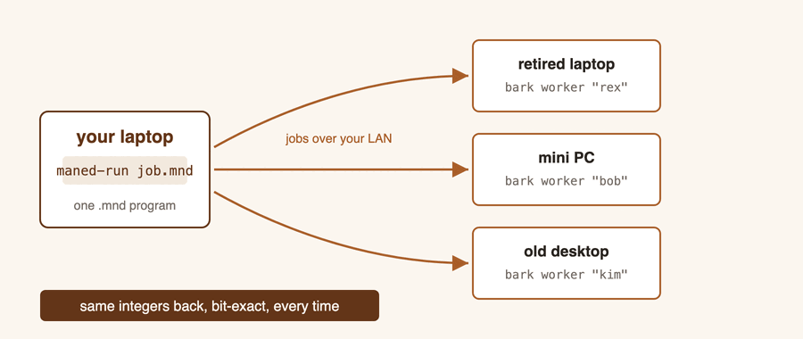

# Why Bark

Training and serving models has collapsed, culturally, into one answer: buy a
GPU. For a large class of real workloads — linear algebra over quantized
integers, classical ML, batch scoring, embedded and edge inference — that
answer buys you floating-point drift, driver stacks, a waiting list and a
power bill, to accelerate arithmetic that never needed floats in the first
place.

**Bark** is the other answer. It turns an ordinary x86-64 computer — a retired
laptop, a thin client, a mini PC from a drawer — into a dedicated compute
worker. You boot it from a USB stick, it appears on your network, and your
Maned programs send it tensor work over HTTP. A fleet of them is a parallel
machine built from hardware you already own.

This page is the case for doing that. [Set up a Bark machine](bark-machines.html)
is the how-to.



## The guarantee a GPU cannot give you

Bark's headline property is not speed. It is that **the answer is bit-exact,
everywhere, always**:

- The same program produces **the same bytes** on your laptop, on one worker,
  on eight workers, on this run and on every future run.
- Splitting a job across machines or cores **cannot move a single value**.
  Work divides into fixed bands decided by shape, never by timing.
- `maned-run --verify` re-runs any routed flow locally and compares every
  output exactly — so the claim is **checked on your data**, not asserted in
  a brochure.

Floating-point accelerators cannot promise this. Parallel float reduction is
order-dependent by nature: the same model on the same card can produce
different low bits run to run, and different results again on the next
driver. For many workloads that is tolerable. For auditable pipelines,
regulated decisions, reproducible research, consensus between independent
parties, or just debugging — "the same answer every time, provably" is the
feature, and it is Bark's foundation rather than an option.

## What a Bark machine is

- **A machine that does one thing.** Bark boots in well under a second and
  the whole computer becomes a tensor worker: no operating system to
  administer, no accounts, no updates pulling it sideways, nothing else
  competing for it.
- **Stateless by default.** The system loads to RAM at boot; you can pull the
  stick out and the worker keeps serving. Installing to the internal disk is
  one keypress when you want a machine that survives power cuts unattended.
- **Zero-configuration on your network.** Workers announce themselves to the
  toolchain; `maned-run devices` lists them; a `device::` block in your
  script names one and `@device(alias)` routes a flow to it.
- **Private by construction.** Your tensors travel from your machine to your
  worker on your LAN. Nothing is uploaded, metered, or shared with anyone.

```text
$ maned-run devices
ALIAS    KIND  ADDRESS            BUSY  OPS
rex      x86   10.0.0.21:4780     no    matmul,add,sub,mul,div,relu,...
bob      x86   10.0.0.22:4780     no    matmul,add,sub,mul,div,relu,...
```

## Replacing a GPU for algebraic work

The arithmetic Maned ships — matmul chains, convolutions, reductions,
activations, the ten `calc::ml::` training algorithms — is exactly the
arithmetic Bark executes, as pure integer kernels tuned per machine. What
that is worth, measured on the project's own two test machines (a 2019-class
laptop chip and a desktop mini PC) and verified on hardware:

- A 12-step chain of 192×192 matrix multiplications completes in
  **under 30 ms** end to end over the network.
- The current convolution path runs the same job **5.3–5.7× faster** than
  the same worker did one optimization campaign ago — same machines,
  measured at the bench before and after.
- The packed integer tier multiplies 16-bit weights at **5.5–5.8× fewer
  worker cycles** than the 32-bit path (2.2–2.8× on the wall clock of a
  whole job, where transfer time shares the bill — both numbers are real,
  they answer different questions).
- Uploads of integer tensors are **3.2–4× smaller and faster** than naive
  encoding, because narrow values ride the wire at their natural width.

Honesty about where the time goes: for short jobs on large tensors, moving
the data dominates computing on it — which is also true of a GPU across a
PCIe bus. Bark's economics favor work that stays resident and compute-dense:
training rounds, long chains, many flows pipelined to the same fleet.
[Training across Bark devices](guides/ml-parallel.html) shows the fleet
patterns that exploit this.

### When a GPU is still the right tool

If your workload is float-native — training large neural networks in
BF16/FP16, serving models whose weights must stay float — a GPU is the right
instrument and Bark does not pretend otherwise. Bark replaces the GPU where
the arithmetic is, or can be, exact integers at a declared scale: Maned's
entire language is designed to put real workloads in that category (see
[Packed weights](packed-weights.html) for how float model files cross the
boundary exactly once, with the loss counted).

## What it costs

A Bark worker is a USB stick plus any x86-64 machine you can reformat, plus a
USB Ethernet adapter. There is no license, no subscription, and no cloud
account. The machines most offices discard on a refresh cycle — still
perfectly good at integer arithmetic — are the target hardware. Adding a
second worker to a fleet is: write the stick, boot it, name it in a script.

```mnd
device::rex { host = "10.0.0.21"; port = 4780; user = "maned"; pass = env("BARK_PASS"); }

calc::lambda_flow mm(a, b) @device(rex) {
    a b matmul r =
} return r;
```

And trying it costs nothing at all: the toolchain ships the same worker as a
local process, so `host = "local"` gives you the full remote path — identical
compute core, identical results — with no second machine.
[Install](install.html) covers it; [Remote workers](guides/remote-workers.html)
is the complete routing guide.

## Where this is going: FPGA

Bark on x86 is the present tense of a longer design. Everything about Maned —
integer-only values, a declared decimal scale, postfix programs that are
already dataflow graphs, operations with no hidden state — was chosen so that
a program means exactly one thing on *any* conforming executor, including
silicon.

Work toward an FPGA executor exists today, and it is **future work, stated
plainly**:

- The compiler has an experimental MLIR path with an FPGA-oriented dialect —
  matmul on a weight-stationary systolic array, quantize/dequantize and
  activation ops — with a profiling pass that measures a flow's matrix
  multiplications to inform target selection.
- A hardware design for that executor — an INT8 systolic array with its
  control logic and host interface — is written and passes its full
  simulation regression (2,013 checks green). It has not been synthesized to
  a physical board yet, and its throughput figures are design targets, not
  measurements.
- None of this is reachable from the shipped tools. Today, `.mnd` programs
  run on CPUs: your machine, the local VM, and x86 Bark workers.

The reason to say it anyway: the determinism contract above is what makes the
jump possible at all. When an FPGA executor arrives, it will not be "close to"
the CPU results — it will be bit-identical to them, verified by the same
`--verify` that checks a worker today. That is what an integer-only language
buys, and it is why Bark machines you deploy now are the same programming
model as the hardware that comes later.

## Next

- [Set up a Bark machine](bark-machines.html) — from a downloaded image to a
  running worker.
- [Remote workers](guides/remote-workers.html) — routing, async jobs,
  dependency chains, and the local Bark VM.
- [How Maned runs your program](under-the-hood.html) — why the same answer
  comes back from every target.
